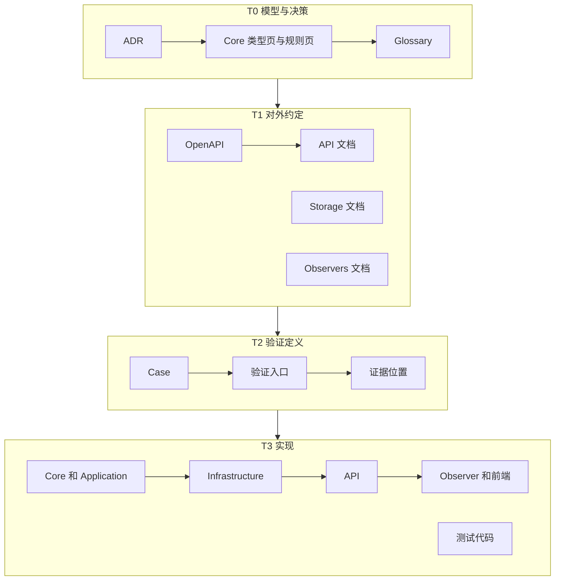
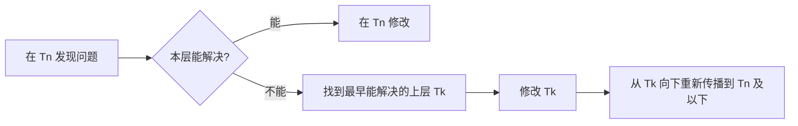

## 背景 [#context]

Heartbeat 由人和 Agent 共同维护。同一条规则会同时出现在模型文档、HTTP 契约、存储说明、Observer 文档、测试和代码中。

如果这些地方都可以先改，读者无法判断哪一处是权威：代码里顺手的写法会反过来改变契约，测试会反过来定义模型。项目正在重写，代码和测试会长期落后于模型，更需要固定权威的位置和更新的方向。

## 决定 [#decision]

- 文档是唯一权威，代码是实现。长期文档只写在 `src/Docs/Heartbeat.Docs/content/docs/`。
- `content/docs/api/openapi.json` 是 HTTP 契约的唯一权威，不由代码生成，也不用来生成客户端代码。
- 文档和代码分为四层，更新只能从模型向实现前向传播。

## 规则 [#rules]

### 权威位置 [#authority]

- 模块 README 只写本模块的运行和操作说明。
- 代码与文档不一致时，以文档为准。
- 后端构建不生成也不覆盖 `openapi.json`。客户端按契约手写实现。

### 四层 [#layers]

编号越小越权威：

| 层 | 名称 | 内容 |
| --- | --- | --- |
| T0 | 模型与决策 | ADR、Core 的类型页和规则页、Glossary |
| T1 | 对外约定 | OpenAPI、API、Storage、Observers 文档 |
| T2 | 验证定义 | Testing 的 Case、验证入口、证据位置 |
| T3 | 实现 | 后端、Observer、前端和测试代码 |

### 前向传播 [#forward]

- 更新只能从 T0 向 T3 传播。上层改了，下层才跟着改。
- 下层与上层冲突时，以上层为准，不得修改下层来改变上层的语义。
- 开始工作前，先找到受影响的最高层，从那一层开始修改。
- 一次变更传播到受影响的最远层才算完成。结束任务时说明传播到了哪一层，以及哪些层没有跟上。
- 修改接口时，同一次提交包含契约、实现和测试。

### 回退 [#fallback]

下层发现的问题在本层解决不了时，回到最早能解决问题的那一层修改，再从那一层重新前向传播：

- 实现写不出来，是因为验证定义有问题：先改 T2，再按新的 T2 改 T3。
- 根源在契约：先改 T1，再依次改 T2 和 T3。
- 根源在模型语义：先改 T0，再依次改 T1、T2 和 T3。

回退修改的是有问题的上层规则，不是让下层反过来定义上层。不得在实现中绕过一条错误的规则，也不得为了迁就实现修改模型。

### 层内顺序 [#internal-order]

没有特殊依赖时，各层内部按下表的顺序修改。依赖关系要求调整顺序时，按依赖调整，并在改动说明中写明原因。

| 层 | 默认顺序 |
| --- | --- |
| T0 | 先在对话中确认，再改 ADR，然后改 Core 的类型页和规则页，最后改 Glossary。只改措辞、不产生新决定时，不改 ADR |
| T1 | 先改 OpenAPI 和 API 文档，再改 Storage 和 Observers 文档。只涉及存储或 Observer 时，两者之间没有先后 |
| T2 | 先写 Case 的预期结果，再更新验证入口，最后更新证据位置 |
| T3 | 先改 Core 和 Application，再改 Infrastructure、API，最后改 Observer 和前端。测试代码按 T2 的 Case 编写 |

### 各层的完成检查 [#layer-check]

| 层 | 检查 |
| --- | --- |
| T0 | ADR 写清决定和理由；规则编号没有重复或复用；Glossary 的定义与类型页一致 |
| T1 | API 文档与 `openapi.json` 不矛盾；链接和锚点有效 |
| T2 | 每条预期结果对应 T1 的一条规则或行为；`caseId` 稳定 |
| T3 | 实现符合 T1；测试覆盖 T2 的 Case |

### 重写期 [#rewrite]

重写期间，T1、T2、T3 可以整体落后于 T0。上层不为了贴合旧实现删除规则，也不在正文中标注实现进度。实现落后由具体任务处理。

### 传播图 [#diagram]

正常的前向传播：

下层解决不了问题时的回退：

## 理由 [#rationale]

文档站同时提供网页、Markdown 导出和 `llms-full.txt`，人和 Agent 读到的是同一份内容。规则写在代码之前，才能在写代码之前讨论规则；否则模型文档只是代码的描述。

权威只能有一个方向。放弃了“由代码生成契约”的做法，因为那样实现细节会反过来定义接口；也放弃了“测试先行定义行为”的做法，因为那样测试会反过来定义语义。固定方向后，评审只需要先确认上层成立，再逐层检查传播是否一致。

回退不是反向传播。错误在最早出现的一层被纠正一次，然后向下同步，不在每个下层重复打补丁。

## 代价 [#costs]

- 每项变更都要先改文档再改代码，小改动也一样。
- 重写期间下层会长期落后于 T0，读者需要知道 T1 到 T3 可能已经过时。
- 不使用代码生成器，客户端和 `openapi.json` 要靠人工保持一致。

## 规则位置 [#details]

- 规则写在本 ADR 的[规则](#rules)一节。
- 仓库根目录的 `AGENTS.md` 保留简要版本，让所有会话和 Agent 工具都能读到。
