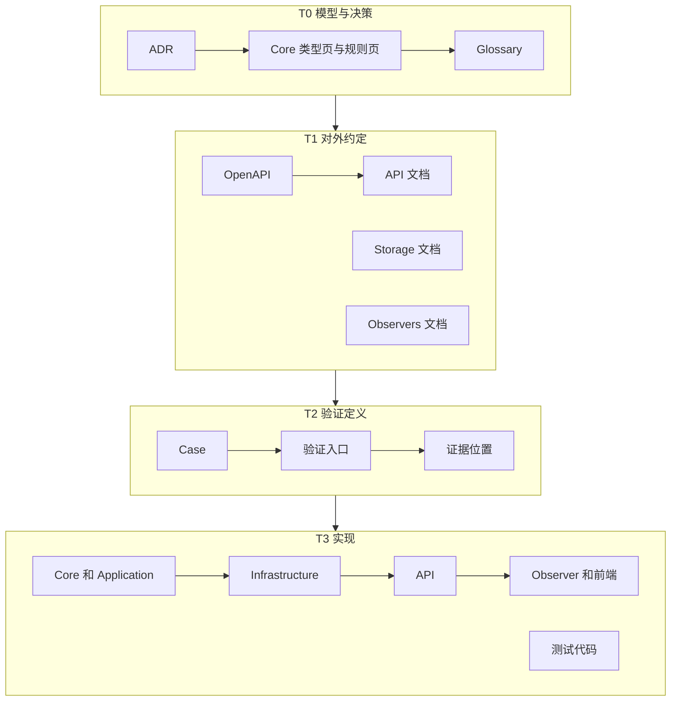
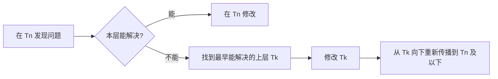

## 背景 [#context]

Heartbeat 由人和 Agent 共同维护。同一条规则会出现在模型文档、HTTP 契约、存储说明、Observer 文档、测试和代码中。每处都能先改，就分不清哪一处是权威：代码的写法会反过来改变契约，测试会反过来定义模型。

## 决定 [#decision]

- 文档是唯一权威，代码是实现。长期文档只写在 `src/Docs/Heartbeat.Docs/content/docs/`。
- `content/docs/api/openapi.json` 是 HTTP 契约的唯一权威，手工维护，客户端按它手写实现。
- 文档和代码分为四层，更新只能从模型向实现前向传播。

## 规则 [#rules]

### 权威位置 [#authority]

- 模块 README 只写本模块的运行和操作说明。
- 代码与文档不一致时，以文档为准。

### 四层 [#layers]

编号越小越权威：

| 层 | 名称 | 内容 |
| --- | --- | --- |
| T0 | 模型与决策 | ADR、Core 的类型页和规则页、Glossary |
| T1 | 对外约定 | OpenAPI、API、Storage、Observers 文档 |
| T2 | 验证定义 | Testing 的 Case、验证入口、证据位置 |
| T3 | 实现 | 后端、Observer、前端和测试代码 |

### 前向传播 [#forward]

- 从受影响的最高层开始修改，向下传播到受影响的最远层才算完成。结束任务时说明传播到了哪一层。
- 下层与上层冲突时，以上层为准。
- 修改接口时，同一次提交包含契约、实现和测试。

### 回退 [#fallback]

下层的问题在本层解决不了时，回到最早能解决它的那一层修改，再从那一层向下传播：

- 根源在验证定义：先改 T2，再改 T3。
- 根源在契约：先改 T1，再依次改 T2 和 T3。
- 根源在模型语义：先改 T0，再依次改 T1、T2 和 T3。

### 层内顺序 [#internal-order]

没有特殊依赖时按下表修改。依赖要求调整顺序时，在改动说明中写明原因。

| 层 | 默认顺序 |
| --- | --- |
| T0 | 先在对话中确认，再改 ADR，然后改 Core 的类型页和规则页，最后改 Glossary。只改措辞时不改 ADR |
| T1 | 先改 OpenAPI 和 API 文档，再改 Storage 和 Observers 文档。只涉及存储或 Observer 时，两者没有先后 |
| T2 | 先写 Case 的预期结果，再更新验证入口，最后更新证据位置 |
| T3 | 先改 Core 和 Application，再改 Infrastructure、API，最后改 Observer 和前端。测试代码按 T2 的 Case 编写 |

### 各层的完成检查 [#layer-check]

| 层 | 检查 |
| --- | --- |
| T0 | ADR 写清决定和理由；规则编号没有重复或复用；Glossary 与类型页一致 |
| T1 | API 文档与 `openapi.json` 一致；链接和锚点有效 |
| T2 | 每条预期结果对应 T1 的一条规则或行为；`caseId` 稳定 |
| T3 | 实现符合 T1；测试覆盖 T2 的 Case |

### 重写期 [#rewrite]

重写期间，T1、T2、T3 可以整体落后于 T0。T0 只写当前的设计，实现进度由具体任务跟踪。

### 传播图 [#diagram]

正常的前向传播：

下层解决不了问题时的回退：

## 理由 [#rationale]

文档站同时提供网页、Markdown 导出和 `llms-full.txt`，人和 Agent 读到同一份内容。规则写在代码之前，才能先讨论规则再写代码。

权威只有一个方向，评审时先确认上层正确，再逐层检查传播。回退在错误最早出现的一层纠正一次，再向下同步。

放弃的方案：

- **由代码生成契约。** 实现细节会反过来定义接口。
- **测试先行定义行为。** 测试会反过来定义语义。

## 代价 [#costs]

- 每项变更都要先改文档再改代码，小改动也一样。
- 重写期间下层会长期落后于 T0。
- 不使用代码生成器，客户端和 `openapi.json` 要靠人工保持一致。

## 规则位置 [#details]

- 规则写在本 ADR 的[规则](#rules)一节。
- 仓库根目录的 `AGENTS.md` 保留简要版本，所有会话和 Agent 工具都能读到。
