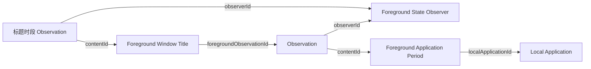

<ObserverStructure node="FOREGROUND_STATE" />

前台状态记录某台设备上系统确认的前台应用和窗口标题。两类观测由同一实例形成，各用一份 Schema 和独立时间线：标题变化不切开应用时段，标题读取失败不影响应用观测。

本业务记录前台时长，不判断用户是否活跃。其他维度见 [Desktop · 记录维度](../desktop/index.mdx#记录维度)。

## Entity 与 Schema

| Entity 与 Schema | 资源名 | 说明 |
| --- | --- | --- |
| [Local Application](./local-application.mdx) | `local-applications` | 设备上的一个应用安装 |
| [Foreground Application Period](./foreground-application-period.mdx) | `foreground-application-periods` | 应用处于前台的时段 |
| [Foreground Window Title](./foreground-window-title.mdx) | 未分配 | 窗口标题时段 |

## 实例身份

- `ObserverId` 标识本机的一个采集器实例；重启或升级时沿用，另一台设备或独立实例使用自己的身份。
- 身份文件由 `--identity-file` 指定，只保存实例 ID；不存在时生成 UUIDv7，损坏时报告错误并保留原文件。
- 同一身份文件只允许一个采集进程运行。
- 本机应用身份使用独立的登记文件，见 [Local Application](./local-application.mdx#登记文件)。

## 采集

- 应用、焦点窗口与标题共用一次状态读取，分别更新应用时段和标题时段。采集由事件触发，并通过定时读取复核，启动时主动读取一次当前状态。
- macOS 的应用激活、焦点窗口切换与当前窗口标题变化都触发状态读取。切换前台应用或焦点窗口后，监听目标随之更新。
- 应用激活事件触发读取，默认每秒再定时确认一次。
- macOS 的休眠通知结束当前时段，唤醒通知触发重新读取。锁屏和无输入不结束前台时段。
- 读取失败时结束当前时段，下次确认时继续。
- 时段规则见 [Foreground Application Period](./foreground-application-period.mdx#事实时间)。
- 标题通过对应的前台应用 Observation 关联本次活动，不保存独立窗口身份；分段规则见 [Foreground Window Title](./foreground-window-title.mdx#记录粒度)。

## 接入与提交策略

已确认的前台应用规则选择[及时提交](../submission/index.mdx#提交策略)。实例接入时，将稳定的 Observer 身份、本机应用 Schema 与前台应用时段 Schema 交给 [.NET 提交 SDK](../submission/dotnet.mdx)，先登记主体与定义。

| 业务事件 | 交给 SDK 的记录 |
| --- | --- |
| 首次确认应用位于前台 | 本机应用、时段内容与 Observation；安排首次上传 |
| 连续确认同一段活动 | 沿用内容与观测身份，补全 Observation 的已确认范围 |
| 切换应用、名称变化或时区变化 | 结束旧记录并提交最后边界，形成新内容与新 Observation |
| 读取失败、停止采集或其他业务中断 | 旧记录结束于最后一次确认；恢复后新建记录 |

业务更新不要求每次采样都触发网络请求。

异常退出后，下次启动按已持久保存的最后确认边界结束遗留时段。主体身份不变，停机期间不计入时段；新读数不连接到停机前的旧记录。

### 本地记录与发送

macOS 实现用 SQLite 保存进行中的时段和待发送内容，SQLite 是这两类数据的本地权威来源。

- 进行中的时段只在本地更新，结束后才进入 Outbox。后端只看到已结束的时段。
- 结束旧时段、写入 Outbox 和保存新时段在同一个本地事务中完成。
- Outbox 保存一个时段的完整提交内容，发送期间不重新生成 ID、字段或时间。
- 发送方先读取每个实体。实体不存在时提交，存在且内容一致时视为已保存，存在但内容不一致时保留记录并报告错误。一个时段的全部实体都读回一致后，才删除这条 Outbox 记录。

已结束的时段不再变化，所以读回一致就能证明保存成功，不需要另设确认接口。读回比较也能处理“后端已保存但响应丢失”的情况。断网和 HTTP 错误不阻塞采集。

## 相关文档

### 平台接口

- [应用激活通知](https://developer.apple.com/documentation/appkit/nsworkspace/didactivateapplicationnotification)
- [焦点窗口变化通知](https://developer.apple.com/documentation/applicationservices/kaxfocusedwindowchangednotification)
- [标题变化通知](https://developer.apple.com/documentation/applicationservices/kaxtitlechangednotification)

### 平台实现

| 平台 | 应用时段 | 窗口标题 |
| --- | --- | --- |
| macOS | 已实现：本机应用身份、连续时段、提交与读回 | 未实现 |
| Windows | 未实现 | 未实现 |
| Android | 未实现 | 未实现 |

macOS 程序位于 `src/Observers/Heartbeat.Observer.ForegroundState/`，通过 AppKit 读取前台应用，支持持续采集和指定采样次数。启动参数见该目录的 README。

### 测试说明

- [本机应用身份](../../testing/observers/local-application-identity.mdx)
- [时段边界](../../testing/observers/application-period-boundaries.mdx)
- [时段保存](../../testing/observers/period-submission.mdx)
- [Outbox 恢复](../../testing/observers/outbox-recovery.mdx)

## 待定

- Android 来源身份、重复查询与 Activity 生命周期的映射。
- 本地记录与发送尚未统一到 [.NET 提交 SDK](../submission/dotnet.mdx)。当前实现“只发送已结束的时段，读回一致才删除”，提交机制描述的是“及时提交，收到 `201` 或 `204` 即确认”。
