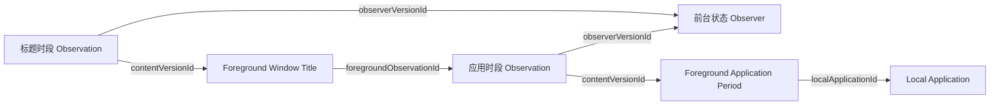

前台状态 Observer 记下某台设备上系统确认的前台应用和窗口标题。两种观测由同一个程序实例形成，各有自己的 EntitySchema 和时间线：标题变化时，应用时段照样延续；标题读取失败时，应用时段照样记录。

它记下的是前台时长。用户是否活跃由读取方组合多条时间线判断，见 [Desktop · 各自的时间线](../desktop/index.mdx#timelines)。

<ObserverStructure node="FOREGROUND_STATE" />

## 实体 [#entities]

| 实体 | 资源名 | 说明 |
| --- | --- | --- |
| [Local Application](./local-application.mdx) | `local-applications` | 设备上的一个应用安装 |
| [Foreground Application Period](./foreground-application-period.mdx) | `foreground-application-periods` | 应用处于前台的一个时段 |
| [Foreground Window Title](./foreground-window-title.mdx) | 待定 | 窗口标题的一个时段 |

## 程序实例 [#instance]

- 一个程序实例对应本机上运行的一个前台状态 Observer。它重启或升级后沿用原来的 EntityId；另一台设备上的、或独立运行的实例，各有自己的 EntityId。
- 身份文件由 `--identity-file` 指定，只保存程序实例的 EntityId。文件不存在时生成一个 UUIDv7；文件损坏时报告错误，并保留原文件。
- 一个身份文件同时只允许一个进程使用。
- 本机应用的身份保存在单独的登记文件中，见 [Local Application · 登记文件](./local-application.mdx#registry)。

## 采集 [#collection]

应用、焦点窗口和标题在同一次读取中取得，再分别更新应用时段和标题时段。读取由三种情况触发：

- 启动时，读取一次当前状态。
- macOS 报告应用激活、焦点窗口切换或窗口标题变化时，立即读取。切换应用或焦点窗口后，监听目标随之更新。
- 默认每秒定时读取一次，确认当前状态。

macOS 即将休眠时，当前时段结束；唤醒后重新读取。读取失败时，当前时段也结束，下一次成功读取开始新的时段。锁屏和无输入不影响前台时段。时段边界的完整规则见 [Foreground Application Period · 事实时间](./foreground-application-period.mdx#fact-time)。

标题通过所属的应用时段 Observation 关联到这一段活动，窗口本身没有身份。标题怎样分段，见 [Foreground Window Title · 粒度](./foreground-window-title.mdx#granularity)。

## 提交 [#submission]

前台状态 Observer 采用[结束后提交](../submission/index.mdx#strategies)：进行中的时段只在本地更新，结束后才上传，所以后端只看到已结束的时段。业务事件对应的本地操作如下：

| 业务事件 | 本地操作 |
| --- | --- |
| 首次确认应用在前台 | 保存本机应用、时段内容和 Observation |
| 再次确认同一段活动 | 沿用内容和 Observation 的身份，延长 Observation 的结束边界 |
| 切换应用，或应用名称、时区变化 | 结束当前时段，提交最后的边界；为新状态形成新的内容和 Observation |
| 读取失败、停止采集或其他中断 | 当前时段结束于最后一次确认；恢复后新建时段 |

程序异常退出后，下次启动时，遗留的时段结束于本地保存的最后一次确认。程序实例的身份不变，停机期间不计入时段，新的读数开始新的时段。

### 本地保存与发送 [#local-store]

macOS 实现用 SQLite 保存进行中的时段和待发送的内容，SQLite 是这两类数据在本机的权威来源。

- 结束当前时段、把它写入 Outbox、保存新的时段，三步在同一个本地事务中完成。
- Outbox 保存一个时段的完整提交内容。发送期间，ID、字段和时间都保持原样。
- 发送时，先逐个读取时段涉及的实体：实体不存在就提交；存在且内容一致，视为已保存；存在但内容不一致，保留 Outbox 条目并报告错误。一个时段的全部实体都读回一致后，才删除它的 Outbox 条目。

已结束的时段不再变化，所以读回一致就能证明保存成功，也能处理“后端已保存、响应却丢失”的情况。断网和 HTTP 错误只影响发送，采集照常进行。

## 实现 [#implementation]

| 平台 | 应用时段 | 窗口标题 |
| --- | --- | --- |
| macOS | 已实现：本机应用身份、连续时段、提交与读回 | 未实现 |
| Windows | 未实现 | 未实现 |
| Android | 未实现 | 未实现 |

macOS 程序在 `src/Observers/Heartbeat.Observer.ForegroundState/`，通过 AppKit 读取前台应用，可以持续采集，也可以只采样指定的次数。启动参数见该目录的 README。

用到的 macOS 接口：[应用激活通知](https://developer.apple.com/documentation/appkit/nsworkspace/didactivateapplicationnotification)、[焦点窗口变化通知](https://developer.apple.com/documentation/applicationservices/kaxfocusedwindowchangednotification)、[标题变化通知](https://developer.apple.com/documentation/applicationservices/kaxtitlechangednotification)。

测试 Case：[本机应用身份](../../testing/observers/local-application-identity.mdx)、[时段边界](../../testing/observers/application-period-boundaries.mdx)、[时段保存](../../testing/observers/period-submission.mdx)、[Outbox 恢复](../../testing/observers/outbox-recovery.mdx)。

## 待定 [#open]

- Android 上来源身份、重复查询与 Activity 生命周期的对应关系。
- 本地保存与发送还没有改用 [.NET SDK](../submission/dotnet.mdx)。目前的实现用读回确认保存；SDK 的约定是收到 `201` 或 `204` 即确认。
