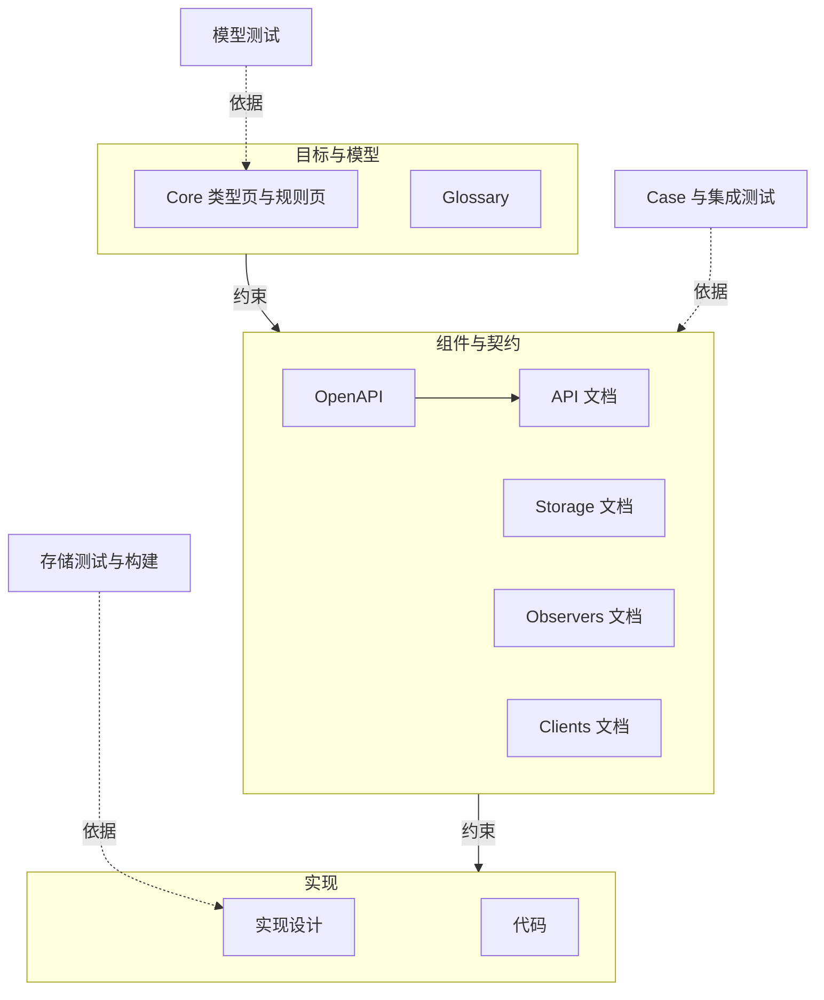
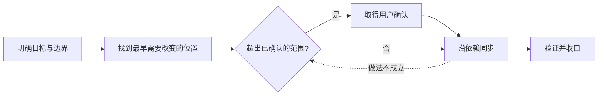

## 背景 [#context]

Orisumi 由人和 Agent 共同维护。同一条规则会出现在模型文档、HTTP 契约、存储说明、Observer 文档、测试和代码中。每处都能先改，就分不清哪一处是权威：代码的写法会反过来改变契约，测试会反过来定义模型。

一个 idea 从提出到实现，要回答几个问题：这次要解决什么，从哪里开始改，哪些决定由用户确认，改动影响到哪些地方，怎样才算完成。

## 决定 [#decision]

- 文档是唯一权威，代码是实现。长期文档只写在 `src/Docs/Orisumi.Docs/content/docs/`。
- `content/docs/api/openapi.json` 是 HTTP 契约的唯一权威，手工维护，客户端按它手写实现。
- 设计分为三层：目标与模型、组件与契约、实现。决定按内容归层，上层约束下层。
- 变更从现有设计与目标之间最早需要改变的位置开始，沿实际依赖同步，以验证证据收口。
- 超出已确认范围的决定由用户确认，范围内的工作由代理完成。验证的力度按风险决定。
- 每项要求由直接依据它的检查验证，检查贯穿三层。

## 规则 [#rules]

本节规定怎样修改三层的内容。

### 三层 [#layers]

| 层 | 回答的问题 | 写在哪里 |
| --- | --- | --- |
| 目标与模型 | 产品解决什么，概念是什么意思，所有数据共用哪些规则 | Core 的类型页和规则页、Glossary，以及这类决定的 ADR |
| 组件与契约 | 哪个组件负责什么，组件对外承诺什么，组件之间怎样协作 | OpenAPI、API、Storage、Observers、Clients 文档，以及这类决定的 ADR |
| 实现 | 在上两层的约束内具体怎样做 | 实现设计写在 ADR 和组件文档的相应小节，其余在代码和测试中 |

决定按内容归层，与所在的文件和目录无关。例如“一次提交遇错即停”是 Core 规则，“JSON 键的顺序不影响比较”是 API 约定，Storage 中“查询走以类型开头的索引”是实现设计。所有数据共用的含义由 Core 定义。

单个 Observer 的业务约定写在该 Observer 的文档中，属于组件与契约，例如原路径重装是否沿用本机应用身份、前台时段何时结束。这些约定遵守 Core，只约束这个 Observer。

下层在上层留下的自由度内补充决定。同一层可以同时有决定、详细规范和代码；代码实现文档中的决定，两者不一致时以文档为准。

ADR 可以属于任何一层。一篇 ADR 的决定分属多层时，它的“规则位置”一节分别指向各自的规则。

### 变更的顺序 [#forward]

1. 明确目标：写清要解决的问题、完成后可以观察到的改善和本次的边界。实现细节和完整的影响范围在后面的步骤中确定。
2. 找到起点：现有设计与目标之间最早需要改变的位置。例如 Core 已经区分已删除和不存在的实体，接口要表达这个区别时，从契约开始改，再检查 Storage 是否支持、消费者和测试。实现违反已有的规范时，起点是实现，修复后验证。
3. 确认：涉及超出已确认范围的决定时，先按[确认](#confirmation)取得用户的确认。
4. 沿依赖同步：找出依赖被改内容的位置，包括同层的其他文档、下层、接口的消费者、测试和文档，例如先改 `openapi.json`，再改 API 文档、后端和客户端。链接可以帮助找到这些位置，影响按内容判断。每个受影响的位置要么同步，要么写明不用改的理由。
5. 验证并收口，见[验证](#verification)和[收口](#closing)。

### 回退 [#fallback]

实施中发现原来的做法不成立时，按新做法的范围处理：

- 新做法仍在已确认的范围内：代理调整做法，继续工作。
- 新做法要改变已确认的行为或重要取舍：带着原因和可选方案回到对应的决定，确认后从那一层重新向下同步。
- 发现与本次目标无关的问题：记在 `.scratch/` 中，另行处理。

### 权威与冲突 [#authority]

处理不一致时，先分清信息的性质：

| 信息 | 所在位置 | 作用 |
| --- | --- | --- |
| 已确认的要求 | 文档，以及用户在当前任务中确认的新决定 | 判断对错的依据 |
| 建议 | 讨论记录和 `.scratch/` 中尚未采纳的方案 | 交给用户决定 |
| 实现 | 代码 | 按要求修改 |
| 证据 | 测试报告和检查记录 | 说明某次检查发生了什么 |

用户在当前任务中确认的新决定，可以作为修改旧文档的依据，并在本任务中写入文档。

- 一条规则只写在一处，其他位置链接过去。模块 README 只写本模块的运行和操作说明。
- 代码与适用的规范不一致：实现不符合要求，修改代码。
- 契约与模型不一致：修改契约。目标需要改变模型时，先按[确认](#confirmation)取得确认，再修改模型并向下同步。
- ADR 与详细规范不一致：设计记录没有同步。追溯用户确认过的决定，把两处改成一致；依据不明时，把具体的冲突交给用户决定。在此之前，实现按详细规范做，并在任务中记下这处冲突。
- 测试报告描述某次运行。依据改变后怎样看待旧报告，见 [ADR · 开发验证与测试证据](./verification.mdx#rationale)。

### 确认 [#confirmation]

以下决定需要用户确认：

- 改变目标、模型语义或用户可以观察到的行为。
- 重要的取舍，例如引入持续的费用或新的部署依赖。
- 现有要求不足以在几个方向之间做出选择。

这些决定可以出现在任何一层。用户在任务中明确提出的改动本身就是确认。改变模型语义时逐项确认，Core 只记录已确认的结构与语义。

其余工作由代理在已确认的范围内完成：落实已确认的决定、选择实现方式、修复偏离规范的实现、同步字段名和链接。例如删除实体时是否一起删除依赖它的数据，是语义取舍，需要确认；按已定的删除规则实现事务，由代理完成，并做严格的验证。

### 任务分工 [#tasks]

文档和实现由不同的任务负责。文档任务修改文档站、README、`AGENTS.md` 和 skill，完成设计的同步和交接。实现任务修改代码和测试，完成验证。

- 修改接口时，文档任务先改契约，实现任务在一次改动中同步生产者、消费者和测试。
- 实现任务发现文档需要修改时，找到最早能解决问题的位置，把需求写进 `.scratch/<feature-slug>/doc-requests.md`，交给文档任务。每条需求写明位置、问题和希望表达的意思。

### 重写期 [#rewrite]

重写期间，组件与契约、实现两层可以落后于已确认的设计，进度由具体任务跟踪。设计已经写完、实现还没有同步时，收口写明未同步的范围和承接的任务。

### 验证 [#verification]

需要验证的要求都有对应的检查，检查直接依据要求所在的位置。Core 规则由模型测试验证，测试按规则编号关联；接口约定由 Case 和集成测试验证；实现设计选择相应的检查，例如存储测试和构建。Case 的写法见 [Testing · Case](../testing/index.mdx#cases)，证据的规则见 [ADR · 开发验证与测试证据](./verification.mdx)。

验证的力度看出错的后果、影响范围、能否撤回，以及错误是否容易发现。影响小的修改做必要的检查。删除、事务这类高风险的改动，用针对性的测试和组合场景提供更充分的证据。风险决定需要多少证据，哪些决定需要用户确认由[确认](#confirmation)一节划定。

#### 各层的检查 [#layer-check]

| 层 | 检查 |
| --- | --- |
| 目标与模型 | ADR 写清决定和理由；规则编号没有重复或复用；Glossary 与类型页一致 |
| 组件与契约 | API 文档与 `openapi.json` 一致；组件文档与 Core 一致 |
| 实现 | 实现符合适用的上层要求；Case 的预期与测试断言逐项对应 |
| 所有层 | 链接和锚点有效 |

### 收口 [#closing]

结束任务时说明：

- 最初的问题是否解决。
- 同步了哪些位置，哪些位置确认不用改。
- 证据覆盖的范围：实际执行了哪些检查，结果和条件是什么。
- 未完成和未验证的部分，以及承接它们的任务。

### 图 [#diagram]

三层之间的约束，以及检查依据的位置：

实线是设计约束，虚线是检查与它依据的要求。ADR 按决定的内容分布在三层中，图中没有单独画出。

一次变更的步骤：

## 理由 [#rationale]

文档站同时提供网页、Markdown 导出和 `llms-full.txt`，人和 Agent 读到同一份内容。规则写在代码之前，才能先讨论规则再写代码。

三层按决定回答的问题划分。原来的四层把文档的形式和验证也排进了权威序列：所有 ADR 都在最高层，可实体存储的索引选择是实现设计；验证定义是契约和实现之间必经的一层，可模型测试直接依据 Core 规则。按内容归层后，每项决定只受上层约束，检查按要求所在的位置选择。

变更从最早需要改变的位置开始，评审时先确认这个位置正确，再沿依赖检查同步。只涉及接口的 idea 从契约开始，实现错误直接修实现，正确的规范保持原样。

确认按决定的归属划分，验证按风险划分。原来实施中的每项决定都要先确认，已经确认过的方向会被反复询问；层级和改动大小也对应不上由谁决定。高风险的实现由代理完成，再用更充分的证据支持。

放弃的方案：

- **由代码生成契约。** 实现细节会反过来定义接口。
- **测试先行定义行为。** 测试会反过来定义语义。
- **给每篇 ADR 标一个 T0–T3 层号，保留四层序列。** 跨层的 ADR 只能取一个层号，验证仍是必经的中间层。

## 代价 [#costs]

- 改变行为的变更要先改文档再改代码，小改动也一样。
- 归层要看决定的内容，同一页中的内容可能分属不同的层。
- 确认的边界靠判断。代理把需要确认的决定当成实现选择时，要到用户评审时才能发现。
- 重写期间，下两层会长期落后于已确认的设计。
- 不使用代码生成器，客户端和 `openapi.json` 要靠人工保持一致。

## 规则位置 [#details]

- 规则写在本 ADR 的[规则](#rules)一节。
- 仓库根目录的 `AGENTS.md` 保留简要版本，所有会话和 Agent 工具都能读到。
- Case、测试报告和证据的规则见 [Testing](../testing/index.mdx) 和 [ADR · 开发验证与测试证据](./verification.mdx)。
