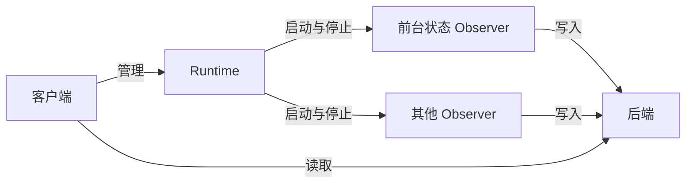

设备端客户端常驻在一台设备上，托管这台设备上的 Observer：安装、更新和卸载，启用和停用，故障后重启，显示运行状态，管理设置和登录时启动。每个平台的客户端都遵守本页，用原生界面编写，各自的界面见 [macOS](./macos.mdx)。

例如用户在 Mac 上装好客户端，附带的前台状态 Observer 随即开始记录 VS Code 在前台的时段。用户晚上停用它，当前时段结束于最后一次确认并保存；第二天再启用，它以原来的身份接着记录，停用期间是空白。

## 客户端与 Runtime [#runtime]

客户端启动一个 [Runtime](../hosting/runtime.mdx)，Runtime 运行各 Observer 的进程，并把它们的写入转发给后端，断网时留到联网后再发。客户端向 Runtime 发出管理指令、读取状态，再用 Runtime 给出的[连接](../hosting/protocol.mdx#connection)从 API 读取数据：

Observer 停下的原因有停用、卸载、更新、崩溃和退出客户端。每一种情况下，程序实例的身份、设置和业务数据目录都保留，再次运行时沿用。正常停下时，Observer 先写入进行中的事实；崩溃时，还没有提交的数据丢失。各种情况的区别写在下面各节中。

## 安装与卸载 [#install]

客户端列出官方目录中适用于本机的 Observer，用户点一下安装。别人写的 Observer，用户给出安装包的地址，安装就代表信任这个程序。随客户端附带的 Observer 在客户端第一次启动时安装，之后和其他 Observer 一样管理。安装包的格式和安装步骤见 [Hosting · Packages](../hosting/packages.mdx)。

Observer 安装后直接开始采集。

卸载移除 Observer 的程序，后端已保存的记录不受影响。用户卸载了附带的 Observer，客户端之后启动或升级时不会把它装回来。重新安装后，Observer 以原来的身份直接开始采集。

## 启用与停用 [#enable]

每个程序实例单独启用和停用，互不影响。同一个安装包可以有多个程序实例，每个有自己的设置。

停用的 Observer 停止采集，程序保留。当前进行中的事实按这个 Observer 停止采集时的规则结束，例如前台时段结束于最后一次确认，见 [Foreground State · 采集](../observers/foreground-state/index.mdx#collection)。停用期间没有读数，记录中是空白。

启用状态跨客户端重启保持。本机离线时，启用和停用立即生效，联网后同步到后端，见 [Management](./management.mdx)。

## 更新 [#updates]

官方目录中有新版本时，客户端提示用户，用户确认后才安装。更新作用于使用这个安装包的全部程序实例。新包下载并校验完之后，旧版本才停止，切换到新版本。准备新包失败时，旧版本继续运行。

更新保留启用状态：更新前在采集的 Observer，更新后继续采集；停用的保持停用。新版本切换后无法启动时，客户端显示错误，不自动退回旧版本，因为新版本可能已经改写了业务数据。

## 故障恢复 [#recovery]

Observer 意外退出后，Runtime 自动重启它，最多三次。仍然失败时，客户端显示错误，并提供重试的入口。只有用户启用的 Observer 会被重启。次数、间隔和计数的清零见 [Runtime · 重启](../hosting/runtime.mdx#restart)。

一个 Observer 的故障只影响它自己。Runtime 本身意外退出时，客户端重新启动它。

## 写入出问题 [#rejected]

后端拒绝一次写入时，其他写入照常，客户端发一条系统通知，并在这个 Observer 的详情中显示被拒绝的数量和最近的原因。用户修好 Observer 后，在这里重发它们，见 [Runtime · 本地转发](../hosting/runtime.mdx#forwarding)。断网时详情显示等待转发的请求数，这时不通知。

## 运行与退出 [#lifecycle]

桌面客户端关闭窗口后，继续在菜单栏或系统托盘中运行，采集照常进行。

退出客户端时，Runtime 先让所有 Observer 停止采集，见 [Runtime · 退出](../hosting/runtime.mdx#shutdown)。下次启动时，客户端运行退出前启用的 Observer。

## 最近的数据 [#recent]

客户端为每个 Observer 显示运行状态，以及最近的 Observation。数据从 [API](../api/reading.mdx) 读取，所以 Observer 停用或崩溃后，数据仍可读取；后端不可用时读不到，还在本地转发中的数据也读不到。一次刷新取得一份结果列表，这次浏览在这份列表上翻页；刷新重新查询并替换它，后端已删除的不再显示。

Observer 的专用视图用原生界面写在客户端中，随客户端发布，例如前台状态 Observer 的今日时间线，见 [macOS · 今天的前台应用](./macos.mdx#today)。新安装的 Observer 没有专用视图时，客户端显示它的状态和最近的数据。专用视图负责这种业务的统计和展示，它出错不影响采集。

更早的日期和追溯在 [Web 控制台](./web.mdx)中查看，客户端提供入口。

## 待定 [#open]

- 官方目录和安装包的托管位置；各平台的签名与分发验证。
- 系统权限的引导、用户登录、本地数据的清理。
- Android 上 Observer 怎样安装、在后台运行、与客户端通信。
