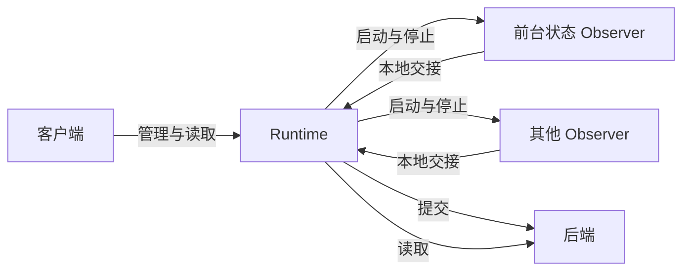

用户通过客户端使用 Orisumi。[Web 控制台](./web.mdx)在浏览器中读取和追溯全部记录；设备端客户端常驻在一台设备上，运行这台设备上的 Observer，并展示它们最近记下了什么。两者都通过 [API](../api/index.mdx) 访问后端。

客户端只托管 Observer，陈述由形成它的 Observer 负责，见 [OBSERVER-6](../core/model/observer.mdx#observer-6)。所以 Observation 的 Observer 仍是各个程序实例，记录中不出现客户端。这样分工的理由见 [ADR · 设备端客户端](../adr/device-client.mdx)。

## 平台 [#platforms]

| 客户端 | 类型 | 状态 |
| --- | --- | --- |
| [Web](./web.mdx) | 浏览器 | 已实现 |
| [macOS](./macos.mdx) | 设备端 | 已实现：经 Runtime 托管，附带前台状态 Observer；官方目录尚未托管 |
| Windows | 设备端 | 规划中 |
| Android | 设备端 | 规划中 |

## 设备端客户端 [#device]

设备端客户端托管本机的 Observer：安装、更新和卸载，启用和停用，故障后重启，显示运行和发送状态，管理设置和登录时启动。每个平台的客户端用原生界面编写。

例如用户在 macOS 上装好客户端，附带的前台状态 Observer 随即开始记录 VS Code 在前台的时段。用户晚上停用它，当前时段结束于最后一次确认，还没发送的时段继续上传；第二天再启用，它以原来的身份接着记录，停用期间是空白。

客户端启动一个 [Runtime](./runtime.mdx)，Runtime 运行各 Observer 的进程，本地保存它们交来的数据并发送到后端。客户端向 Runtime 发出指令，从 Runtime 读取状态和数据：

### 安装与卸载 [#install]

客户端列出官方目录中适用于本机的 Observer，用户选择后安装。随客户端附带的 Observer 在客户端第一次启动时安装，之后和其他 Observer 一样管理。安装包的格式和安装步骤见 [Packages](./packages.mdx)。

Observer 安装后直接开始采集。

卸载移除 Observer 的程序，保留程序实例的身份、设置和本地数据；后端已保存的记录不受影响，待发送的版本继续发送。用户卸载了附带的 Observer，客户端之后启动或升级时不会把它装回来。重新安装后，Observer 沿用原来的身份和设置，并直接开始采集。

### 启用与停用 [#enable]

每个 Observer 单独启用和停用，互不影响。

停用的 Observer 停止采集，程序保留。当前进行中的事实按这个 Observer 停止采集时的规则结束，例如前台时段结束于最后一次确认，见 [Foreground State · 采集](../observers/foreground-state/index.mdx#collection)。停用期间没有读数，记录中是空白。

再次启用时，Observer 沿用原来的身份和设置。启用状态跨客户端重启保持。

### 更新 [#updates]

官方目录中有新版本时，客户端提示用户，用户确认后才安装。新包下载并校验完之后，旧版本才停止，切换到新版本。准备新包失败时，旧版本继续运行。

更新保留身份、设置和启用状态：更新前在采集的 Observer，更新后继续采集；停用的保持停用。新版本切换后无法启动时，客户端显示错误，不自动退回旧版本，因为新版本可能已经改写了业务数据。

### 故障恢复 [#recovery]

Observer 意外退出后，Runtime 自动重启它，最多三次。仍然失败时，客户端显示错误，并提供重试的入口。只有用户启用的 Observer 会被重启。次数、间隔和计数的清零见 [Runtime · 重启](./runtime.mdx#restart)。

一个 Observer 的故障不影响其他 Observer，也不影响发送。Runtime 本身意外退出时，客户端重新启动它。

### 发送 [#sending]

发送由 Runtime 完成，见 [Submission · 运行方式](../observers/submission/index.mdx#hosting)。Observer 停用、崩溃或卸载后，它已经交给 Runtime 的数据继续发送。

客户端按 Observer 显示待发送的数量和被拒绝的原因，见 [Submission · 发送状态](../observers/submission/index.mdx#status)。被拒绝的版本由 Observer 的业务代码处理，处理完之前这个实例的发送暂停，其他实例照常发送。Observer 停用或卸载时，被拒绝的版本保留到它再次运行，客户端不会为了处理拒绝而启用它，见 [Submission · 被拒绝的版本](../observers/submission/index.mdx#rejections)。

### 运行与退出 [#lifecycle]

桌面客户端关闭窗口后，继续在菜单栏或系统托盘中运行，采集和发送照常进行。

退出客户端时，Runtime 先让所有 Observer 停止采集，再停止发送，不等网络恢复或全部发送完。待发送的数据留在本地。下次启动时，客户端运行退出前启用的 Observer，并继续发送。

### 最近的数据 [#today]

客户端为每个 Observer 显示运行和发送状态，以及最近的 Observation，包括还没发送的部分。数据经 Runtime 读取，见 [Runtime · 读取](./runtime.mdx#reading)。Observer 停用或崩溃后，数据仍可读取。

Observer 的专用视图用原生界面写在客户端中，随客户端发布，例如前台状态 Observer 的今日时间线，见 [macOS · 今天的前台应用](./macos.mdx#today)。新安装的 Observer 没有专用视图时，客户端显示它的状态和最近的数据。专用视图负责这种业务的统计和展示，它出错不影响采集和发送。

API 不可用时，客户端显示本地的数据，并标明可能不完整。

更早的日期和追溯在 Web 控制台中查看，客户端提供入口。

## 待定 [#open]

- 官方目录和安装包的托管位置；各平台的签名与分发验证。
- 后端删除或修复数据后，本地的数据怎样显示。
- 系统权限的引导、用户登录、本地数据的清理。
- 设置里换了 API 地址、数据目录不变时，数据目录里待发送的版本怎样处理。
- Android 上 Observer 怎样安装、在后台运行、与客户端通信。
