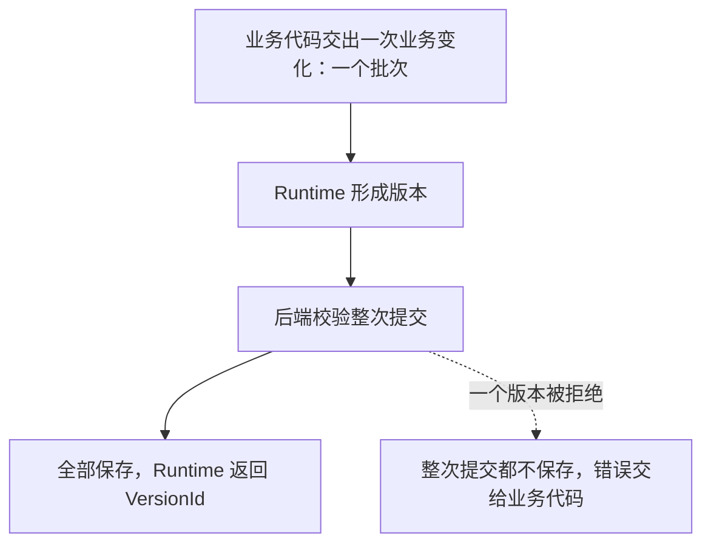

Observer 的业务代码判断事实、交出业务变化；托管方运行它，保管它的身份，把业务变化形成版本并提交给后端。托管方是 [Runtime](./runtime.mdx)。设备上由设备端客户端启动它，服务器上由服务管理器或容器启动它，两处是同一个程序。

[Walkthrough](../start/walkthrough.mdx) 那一天 16:00，用户从 VS Code 切到浏览器。前台状态 Observer 判断 VS Code 的时段到此结束，把这一段交给 Mac 上的 Runtime，由它形成版本并提交给后端。晚上服务器上的 Runtime 运行应用识别 Observer，它读到浏览器这个新的本机应用，形成应用产品，交给的是同一种 Runtime。

## 本分区的页面 [#pages]

| 要做的事 | 读 |
| --- | --- |
| 编写 Observer | [Submission](./submission.mdx)，以及所用语言的 SDK，例如 [.NET](./dotnet.mdx) |
| 发布 Observer 的安装包 | [Packages](./packages.mdx) |
| 编写设备端客户端，或修改 Runtime | [Runtime](./runtime.mdx)、[Protocol](./protocol.mdx)、[Packages](./packages.mdx)、[Management](./management.mdx) |
| 在服务器上运行 Observer | [Server](./server.mdx) |

## 分工 [#division]

| Observer 的业务代码 | 托管方 |
| --- | --- |
| 定义 EntitySchema，读取来源，形成观测内容和 Observation | 保管程序实例的 EntityId，登记程序实例和所需的 EntitySchema |
| 决定粒度、业务对象的身份、历史保留，以及事实何时结束 | 生成 VersionId，接好版本链，上传二进制内容，提交到后端 |
| 处理提交的错误 | 把后端的结果或错误交给业务代码 |
| 持久保存自己的业务状态 | 提供实例的数据目录，执行管理配置，报告状态 |

后端按 Schema 版本和 Core 的规则校验并保存，见 [Core · 谁决定什么](../core/index.mdx#responsibility)。

## 流程 [#flow]

一次业务变化从形成到保存：

提交在业务代码等待时完成。业务代码收到结果时，版本已保存，下一次处理可以读到它们。

## 两种运行方式 [#modes]

| | 设备 | 服务器 |
| --- | --- | --- |
| 谁启动 Runtime | 设备端客户端，客户端退出时一起退出 | 服务管理器或容器，见 [Server](./server.mdx) |
| 本机管理 | 客户端经管道发出指令 | 没有客户端管道 |
| 远程管理 | 经后端，见 [Management](./management.mdx) | 经后端，是唯一的管理方式 |
| 后端的托管方类型 | `device` | `server` |

两种方式的安装包、数据目录、进程管理、提交和远程管理都相同。

## 状态 [#status]

Runtime 为每个程序实例报告两项状态：

| 状态 | 含义 |
| --- | --- |
| 启用 | 程序实例是否应当运行 |
| 运行 | 程序实例现在是否在运行，以及最近一条采集诊断，见 [OBSERVER-8](../core/model/observer.mdx#observer-8) |

两项各自变化。例如程序实例在运行时，来源可能正在读取失败。Runtime 把它们报告给本机客户端，取值见 [Runtime · 状态](./runtime.mdx#states)；也报告给后端，供其他客户端读取，见 [Management · 状态报告](./management.mdx#status)。
