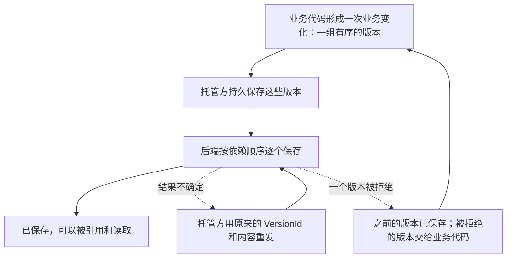

Observer 的业务代码判断事实、形成版本；托管方运行它，保管它的身份，并把它形成的版本可靠地交给后端。设备上的托管方是 [Runtime](./runtime.mdx)，服务端的托管方是 API 进程中的[服务端托管](./server.mdx)。

例如 16:00 用户从 VS Code 切到浏览器。前台状态 Observer 判断 VS Code 的时段到此结束、浏览器的时段开始，形成对应的版本。这些版本怎样留在本机、怎样送到后端，断网、崩溃和重启后怎样继续，都由 Runtime 负责。

## 分工 [#division]

| Observer 的业务代码 | 托管方 |
| --- | --- |
| 定义 EntitySchema，读取来源，形成观测内容和 Observation | 保管程序实例的 EntityId，登记程序实例和所需的 EntitySchema |
| 决定粒度、业务对象的身份、历史保留，以及事实何时结束 | 持久保存交来的版本，按依赖顺序提交，重试和恢复 |
| 处理被拒绝的版本 | 把被拒绝的版本和它的 `rule` 交给业务代码 |
| 设备上：选择提交策略，决定是否写入观测草稿 | 设备上：接好版本链，合并和冻结草稿，写入观测草稿 |

后端按 Schema 版本和 Core 的规则校验并保存，见 [Core · 谁决定什么](../core/index.mdx#responsibility)。

## 流程 [#flow]

一次业务变化从形成到保存，两端走同一条路：

托管方保存这些版本之后，发送就与形成它们的进程无关：进程崩溃、程序实例停止后，托管方照常完成发送。重发沿用 VersionId，后端把已保存的版本直接确认，见 [VERSION-7](../core/model/version.mdx#version-7)。一次提交中途被拒绝时，之前的版本已保存，见 [VERSION-13](../core/model/version.mdx#version-13)；被拒绝的版本怎样处理，由业务代码按业务规则决定。

## 两端的区别 [#sides]

| | Runtime | 服务端托管 |
| --- | --- | --- |
| 运行在 | 设备端客户端启动的进程，Observer 是它的子进程 | API 进程，Observer 是其中的模块 |
| 业务代码怎样使用它 | 通过所用语言的 SDK，经管道通信 | 直接调用 |
| 版本保存在 | 程序实例的本机 SQLite | PostgreSQL 中的未决提交 |
| 业务代码何时继续 | 收到本地回执后 | 后端返回保存的结果后 |
| 状态报告给 | 客户端 | 日志 |

设备可能断网，所以 Runtime 本地保存后就交还业务代码，之后异步发送。服务端托管和后端在一起，业务代码等到保存的结果再继续。两种做法的理由见 [ADR · 提交与 Runtime](../adr/submission.mdx) 和 [ADR · 服务端托管](../adr/server-observer-hosting.mdx)。

## 状态 [#status]

托管方为每个程序实例报告三项状态：

| 状态 | 含义 |
| --- | --- |
| 启用 | 程序实例是否应当运行 |
| 运行 | 程序实例现在是否在运行，以及最近一条采集诊断，见 [OBSERVER-8](../core/model/observer.mdx#observer-8) |
| 发送 | 待发送和已保存的数量，发送错误和被拒绝的版本 |

三项各自变化。例如程序实例停用后，它已经交出的版本照常发送；程序实例在运行时，来源可能正在读取失败。Runtime 报告的取值见 [Runtime · 状态](./runtime.mdx#states)，服务端托管见 [Server Hosting · 报告](./server.mdx#reporting)。

## 本分区的页面 [#pages]

| 要做的事 | 读 |
| --- | --- |
| 编写在设备上运行的 Observer | [Submission](./submission.mdx)，以及所用语言的 SDK，例如 [.NET](./dotnet.mdx) |
| 编写设备端客户端，或修改 Runtime | [Runtime](./runtime.mdx)、[Protocol](./protocol.mdx) |
| 编写在服务端运行的 Observer | [Server Hosting](./server.mdx) |
