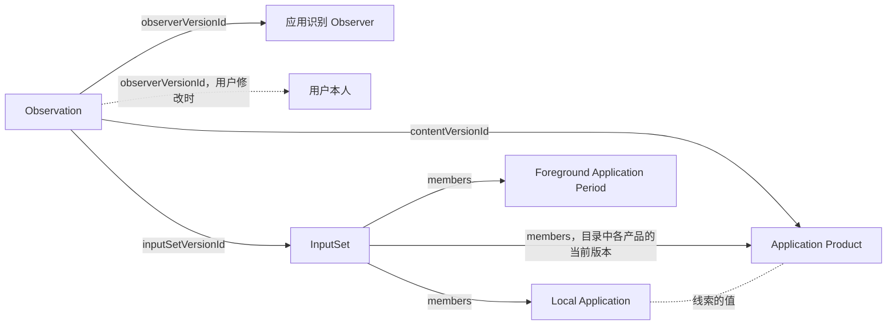

应用识别 Observer 把各设备、各平台上的本机应用归到用户认知中的同一款软件，也就是应用产品。例如两台 Mac 和一部 Android 手机上的 QQ，都归到 QQ 这个产品。它是一个安装包，在服务器上由 [Runtime](../../hosting/server.mdx) 运行，读取后端已保存的本机应用和前台时段，遇到还没有认出的线索时交给模型判断，再把结果写成应用产品的版本。

为什么这样分工，见 [ADR · 应用识别](../../adr/application-identity.mdx)。

<ObserverStructure node="APPLICATION_IDENTITY" />

## 业务类型 [#types]

| 业务类型 | 用途 | 资源名 |
| --- | --- | --- |
| [Application Identity Observer](./application-identity-observer.mdx) | 程序实例自身：应用识别 Observer | `application-identity-observers` |
| [Application Product](./application-product.mdx) | 观测内容：一款软件和属于它的跨设备线索 | `application-products` |

### 归属 [#membership]

Mac A 和 Mac B 上的 QQ 是两个本机应用，它们的应用包标识都是 `com.tencent.qq`。QQ 这个产品的当前版本在 `identifiers` 中列出这条线索，所以两个本机应用都属于 QQ。之后第三台 Mac 装上 QQ，它直接属于 QQ。

归属按以下规则确定，Web 控制台和应用识别 Observer 都这样读取：

- 只有跨设备线索参与归属。哪些 scheme 是跨设备线索，见 [Local Application · 标识线索](../foreground-state/local-application.mdx#identifiers)。
- 本机应用的一条跨设备线索与某个应用产品当前版本中的一项 `identifiers` 的 `scheme` 和 `value` 都相同时，本机应用属于这个产品。比较区分大小写。
- 一条线索写在一个产品中。匹配到多个产品时，本机应用属于当前版本保存时间最晚的那个。
- 没有匹配到任何产品的本机应用未归属，读取方按本机应用单独显示。

归属总是按产品的当前版本计算。产品形成新版本后，按新版本重新归属；本机应用、前台时段和已有的 Observation 保持不变。

## 程序实例 [#instance]

- 每个部署运行一个应用识别 Observer：它的安装包在清单中声明 `scope` 为 `deployment`，第二个实例在登记时被拒绝，见 [Management · 每个部署一个实例](../../hosting/management.mdx#singleton)。它逐条处理线索，判断每条线索时都能读到前面的结果。
- 程序实例的 EntityId 由 Runtime 保存，第一次安装时生成，之后一直沿用，见 [OBSERVER-4](../../core/model/observer.mdx#observer-4)。
- 启动时，它经 Runtime 登记两种业务类型的 EntitySchema 和程序实例。程序版本或模型型号变化时，Runtime 为程序实例形成新版本，之后的 Observation 引用新版本，见 [Submission · 登记](../../hosting/submission.mdx#registration)。
- 进程启动后，它先[恢复](#recovery)上次没有完成的批次，再开始第一轮。轮次由它自己安排，同一时刻只有一轮，上一轮结束后等待一个间隔再开始下一轮。

## 处理 [#processing]

应用识别 Observer 默认每 60 秒运行一轮，读取都经 Runtime 读后端已保存的数据，见 [Protocol · 读取后端](../../hosting/protocol.mdx#observer-reading)：

1. 用 `listEntities` 分页读取全部应用产品的当前版本，建立线索到产品的对照。
2. 用 `listEntities` 分页读取全部本机应用的当前版本，取出跨设备线索。
3. 不在对照中的线索是待识别的线索。逐条处理，每处理完一条就更新对照，再处理下一条。

处理一条线索时，它先收集名称：对拥有这条线索的每个本机应用，用 `listReferrers` 读取引用它的前台应用时段，最多 100 个，取其中的 `name`，去掉空值和重复。接着把线索、名称和产品目录交给模型，按模型的结果写入。

### 模型 [#model]

应用识别 Observer 调用 OpenAI 的 API，型号由[配置](#configuration)给出，记在 Observer 的版本中，所以从 Observation 能查到这次判断用的模型。请求用结构化输出限定回答的格式。

发送的内容：

| 内容 | 例子 |
| --- | --- |
| 平台，取 scheme 的前缀 | `macos` |
| 待识别的线索 | `macos.bundle-id`、`com.tencent.qq` |
| 拥有这条线索的本机应用的全部标识线索 | `macos.executable-path`、`/Applications/QQ.app/Contents/MacOS/QQ` |
| 收集到的名称 | `QQ` |
| 产品目录：每个产品的 EntityId、`name` 和 `identifiers` | VS Code、微信…… |
| 判断标准 | [Application Product · 粒度](./application-product.mdx#granularity) |

模型从三种结果中选一种：

| 结果 | 内容 |
| --- | --- |
| 属于已有的产品 | 产品的 EntityId，必须是目录中的一个 |
| 新的产品 | 产品的名称 |
| 未知 | 无 |

结果为未知时，应用识别 Observer 不提交，记下这条线索，以及当时拥有它的本机应用和收集到的名称。这份记录是它的业务状态，保存在实例的数据目录中，重启后仍在。之后的轮次中，这两项都没有变化时跳过这条线索；出现新的本机应用或新的名称时，重新交给模型。线索归入某个产品后，这条记录随之删除。

### 用户的修改 [#edits]

用户在 Web 控制台中修改应用产品，见 [Web · 应用](../../clients/web.mdx#applications)。应用识别 Observer 按修改后的当前版本工作：

- 用户把一条线索从产品中移出，这条线索在下一轮成为待识别的线索，交给模型重新判断。
- 用户删除一个产品，它的线索都成为待识别的线索。
- 已经在产品中的线索，应用识别 Observer 不再处理。

### 失败 [#failures]

失败作为采集诊断写入标准错误，由 Runtime 报告，见 [OBSERVER-8](../../core/model/observer.mdx#observer-8)。

| 情况 | 处理 |
| --- | --- |
| 没有配置 API Key | 不调用模型，每轮报告诊断 |
| 模型的请求失败或超时；回答不符合格式，或指向目录中没有的产品 | 这条线索不写入，下一轮重试 |
| 读取时后端不可用 | 结束这一轮，下一轮重试 |
| 等待最终结果时后端不可用 | 继续等待；Runtime 用相同的 VersionId 重发，见 [VERSION-7](../../core/model/version.mdx#version-7) |
| 产品的新版本因 [VERSION-6](../../core/model/version.mdx#version-6) 被拒绝 | 丢弃这一批，重新读取产品，再处理这条线索 |
| 提交因其他规则被拒绝 | 丢弃这一批，报告诊断，跳过这条线索，下一轮重试 |
| 收到 `stop` | 结束等待，退出；记录留在数据目录中，下次启动时恢复 |

只有模型回答“新的产品”时才创建产品。

### 配置 [#configuration]

模型型号和间隔是程序实例的设置，在客户端中修改，见 [Clients · Management](../../clients/management.mdx)。API Key 不放进设置，由服务器的运行环境提供，见 [Server · 运行环境](../../hosting/server.mdx#environment)。

| 配置 | 来源 | 含义 |
| --- | --- | --- |
| `OPENAI_API_KEY` | Runtime 的环境变量 | OpenAI 的 API Key |
| `model` | 设置 | 调用的 OpenAI 模型，省略时为默认模型 |
| `intervalSeconds` | 设置 | 两轮之间的间隔，默认 60 |

## 事实时间 [#fact-time]

Observation 的 `startAt`、`endAt` 和 `timeZone` 都是 `null`：这款软件从什么时候起有这条线索，判断时不知道，见 [OBSERVATION-5](../../core/model/observation.mdx#observation-5)。

## 提交 [#submission]

应用识别 Observer 使用 [.NET](../../hosting/dotnet.mdx) 的 SDK，每条线索的结果交给 Runtime 一个批次。

### 写入 [#writes]

属于已有的产品或新的产品时，应用识别 Observer 向 Runtime 交出一个批次，按顺序包含：

| 版本 | 内容 |
| --- | --- |
| InputSet | 拥有这条线索的本机应用版本、读到名称的前台时段版本，以及目录中每个产品的当前版本 |
| 应用产品 | 已有的产品：当前版本加上这条线索，形成新版本。新的产品：首版，`identifiers` 只有这条线索 |
| Observation | Observer 是程序实例的当前版本，观测内容是上面的产品版本，`inputSetVersionId` 指向上面的 InputSet |

- 三个版本都是草稿，在同一个批次中结束，所以随即冻结并发送。
- 已有产品的新版本用 `previousVersionId` 指定读到的当前版本，见 [Protocol · 批次的操作](../../hosting/protocol.mdx#operations)。

交出批次后，它用 `outcome` 等待这一批的最终结果，已保存后才更新对照、处理下一条线索，见 [Submission · 最终结果](../../hosting/submission.mdx#outcome)。

例如 Android 上第一次出现 QQ：线索 `android.package-name`、`com.tencent.mobileqq` 不在对照中，模型回答属于 QQ。批次中是 InputSet、QQ 的新版本（`identifiers` 多了这条线索）和一份 Observation。

### 恢复 [#recovery]

批次交给 Runtime 之前，应用识别 Observer 先把批次的标识和序列化好的请求写进实例的数据目录。收到最终结果后，删除这份记录。

进程启动时，记录还在，说明上次没有确认这一批：它用同一个标识重发原来的请求，Runtime 返回原来的回执，不形成新的版本，见 [Submission · 回执](../../hosting/submission.mdx#receipts)。然后等待这一批的最终结果，再开始新的一轮，所以模型不会为同一条线索再调用一次，也不会再建一个产品。

## 实现 [#implementation]

识别的业务代码在 `src/Observers/Orisumi.Observer.ApplicationIdentity/`，用 .NET 编写，经 .NET SDK 连接 Runtime，发布为 `linux-x64` 等服务器平台的安装包。它调用 OpenAI 的 Responses API，默认模型是 `gpt-6.1-terra`。

测试 Case：[应用识别](../../testing/observers/application-identity.mdx)。

## 待定 [#open]

- 产品目录很大时，只发送一部分候选。
- OpenAI 以外的模型供应商。
