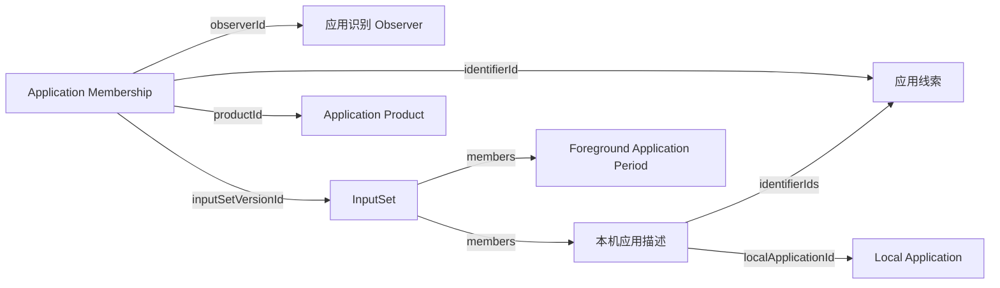

应用识别 Observer 把各设备、各平台上的本机应用归到用户认知中的同一款软件，也就是应用产品。例如两台 Mac 和一部 Android 手机上的 QQ，都归到 QQ 这个产品。它是一个安装包，在服务器上由 [Runtime](../../hosting/server.mdx) 运行，读取后端已保存的本机应用描述和前台时段，遇到还没有归属的线索时交给模型判断，再把结果写成线索归属。这是[模型形成理解](../../core/rules/understanding.mdx)的一个实例。

为什么这样分工，见 [ADR · 应用识别](../../adr/application-identity.mdx)。

<ObserverStructure node="APPLICATION_IDENTITY" />

## 业务类型 [#types]

| 业务类型 | 用途 | 资源名 |
| --- | --- | --- |
| [Application Identity Observer](./application-identity-observer.mdx) | 程序实例的描述 | `application-identity-observers` |
| [Application Product](./application-product.mdx) | 事物：一款软件 | `application-products` |
| [应用线索](#identifiers) | 事物：一条跨设备线索 | `application-identifiers` |
| [Application Membership](./application-membership.mdx) | 判断：一条线索属于哪个产品 | `application-memberships` |

### 应用线索 [#identifiers]

应用线索是一条跨设备线索，例如 macOS 的应用包标识 `com.tencent.qq`。它是一个事物，识别依据的 `scope` 为 `null`，`scheme` 和 `value` 就是线索本身。

| 项目 | 值 |
| --- | --- |
| SchemaId | `019e1bbb-ec00-7000-8000-000000000015` |
| 显示名称 | 应用线索 |
| 说明 | 表示一条跨设备线索，在任何设备上都指同一款软件的同一类安装。 |
| 资源名 | `application-identifiers` |
| `kind` | `thing` |

### 归属 [#membership]

Mac A 和 Mac B 上的 QQ 是两个本机应用，它们的描述都提到 `com.tencent.qq` 这条线索。这条线索有一条线索归属，它指向 QQ 这个产品，所以两个本机应用都属于 QQ。之后第三台 Mac 装上 QQ，它直接属于 QQ。

归属按以下规则确定，Web 控制台和应用识别 Observer 都这样读取：

- 本机应用描述提到一条线索，这条线索在[当前理解](../../core/rules/understanding.mdx#understanding-4)中有线索归属时，本机应用属于 `productId` 指向的产品。
- 指向的产品已删除时，这条线索未归属。
- 没有归属的本机应用未归属，读取方按本机应用单独显示。

判断变化时，本机应用、前台时段和其他线索的判断保持不变。

### 否定 [#retraction]

一条线索归错时，用户写一份 `deny` 的 [Review](../../core/rules/understanding.mdx#review-type)，其他线索不受影响。例如 QQ 音乐的 `com.tencent.qqmusicmac` 被判给 QQ，用户否定这条判断，线索回到未归属。下一轮应用识别 Observer 读到否定，把它交给模型，模型不再给出这个结论；又给出时，Observer 跳过它，见 [UNDERSTANDING-7](../../core/rules/understanding.mdx#understanding-7)。

换了更强的模型时，新判断取代旧判断，旧判断保留，见 [UNDERSTANDING-6](../../core/rules/understanding.mdx#understanding-6)。

用户删除一个产品时，指向它的线索都未归属，模型重新判断。

## 程序实例 [#instance]

- 每个部署运行一个应用识别 Observer：它的安装包在清单中声明 `scope` 为 `deployment`，第二个实例在登记时被拒绝，见 [Management · 每个部署一个实例](../../hosting/management.mdx#singleton)。它逐条处理线索，判断每条线索时都能读到前面的结果。
- 程序实例的 EntityId 由 Runtime 保存，第一次安装时生成，之后一直沿用，见 [OBSERVER-4](../../core/model/observer.mdx#observer-4)。
- 启动时，它声明用到的业务类型，写入自己的描述，见 [API · 负责的 Observer](../../api/writing.mdx#observer)。程序版本或模型型号变化时，描述形成新版本，之后的判断引用新版本。
- 轮次由它自己安排，同一时刻只有一轮，上一轮结束后等待一个间隔再开始下一轮。

## 处理 [#processing]

应用识别 Observer 默认每 60 秒运行一轮，读取后端已保存的数据，见 [API · Reading](../../api/reading.mdx)：

1. 用 `GET /things` 读取全部应用产品和它们的名字，组成产品目录。
2. 用 `GET /observations` 带 `standing=current` 读取当前理解中的线索归属，组成线索到产品的对照。
3. 用 `GET /observations` 读取全部本机应用描述，取出线索。
4. 用 `GET /observations` 读取用户对线索归属的否定。
5. 不在对照中的线索是待识别的线索。逐条处理，每处理完一条就更新对照，再处理下一条。

处理一条线索时，它先收集名称：对拥有这条线索的每个本机应用，用 `GET /entities/{entityId}/referrers` 读取提到它的前台应用时段，最多 100 个，取其中的 `name`，去掉空值和重复。接着把线索、名称、产品目录和这条线索被否定过的结论交给模型，按模型的结果写入。

### 模型 [#model]

应用识别 Observer 调用 OpenAI 的 API，型号由[配置](#configuration)给出，记在 Observer 的描述中，所以每条判断都能查到用的模型。请求用结构化输出限定回答的格式。

发送的内容：

| 内容 | 例子 |
| --- | --- |
| 平台，取 scheme 的前缀 | `macos` |
| 待识别的线索 | `macos.bundle-id`、`com.tencent.qq` |
| 拥有这条线索的本机应用的全部标识线索 | `macos.executable-path`、`/Applications/QQ.app/Contents/MacOS/QQ` |
| 收集到的名称 | `QQ` |
| 产品目录：每个产品的 EntityId、名字和属于它的线索 | VS Code、微信…… |
| 这条线索被否定过的结论 | 不属于 QQ |
| 判断标准 | [Application Product · 粒度](./application-product.mdx#granularity) |

模型从三种结果中选一种：

| 结果 | 内容 |
| --- | --- |
| 属于已有的产品 | 产品的 EntityId，必须是目录中的一个 |
| 新的产品 | 产品的名称 |
| 未知 | 无 |

结果为未知时，应用识别 Observer 不写入，在内存中记下这条线索，以及当时拥有它的本机应用和收集到的名称。之后的轮次中，这两项都没有变化时跳过这条线索；出现新的本机应用或新的名称时，重新交给模型。进程重启后，这些记录清空，未知的线索重新交给模型。

### 失败 [#failures]

失败作为采集诊断写入标准错误，由托管方报告，见 [OBSERVER-8](../../core/model/observer.mdx#observer-8)。

| 情况 | 处理 |
| --- | --- |
| 没有配置 API Key | 写入自己的描述，不调用模型，每轮报告诊断 |
| 本机应用描述的业务类型还没有声明 | 这一轮没有线索 |
| 模型的请求失败或超时；回答不符合格式，或指向目录中没有的产品 | 这条线索不写入，下一轮重试 |
| 读取时后端不可用 | 结束这一轮，下一轮重试 |
| 写入被拒绝或后端不可用 | 报告诊断，跳过这条线索，下一轮重试 |

只有模型回答“新的产品”时才创建产品。

### 配置 [#configuration]

模型型号和间隔是程序实例的设置，在客户端中修改，见 [Clients · Management](../../clients/management.mdx)。API Key 不放进设置，由服务器的运行环境提供，见 [Server · 运行环境](../../hosting/server.mdx#environment)。

| 配置 | 来源 | 含义 |
| --- | --- | --- |
| `OPENAI_API_KEY` | Runtime 的环境变量 | OpenAI 的 API Key |
| `model` | 设置 | 调用的 OpenAI 模型，省略时为默认模型 |
| `intervalSeconds` | 设置 | 两轮之间的间隔，默认 60 |

## 写入 [#submission]

应用识别 Observer 使用 [.NET 的 SDK](../../api/sdk.mdx#dotnet)。它要读到自己写入的结果，才能处理下一条线索，所以它直接写给后端，同步得到结果，见 [API · 两个地址](../../api/writing.mdx#endpoints)。

每条线索的结果是一条线索归属：

| 字段 | 内容 |
| --- | --- |
| `formation` | `inferred` |
| `content` | 这条线索和它属于的产品 |
| `inputs` | 实际用到的版本：拥有这条线索的本机应用描述、读到名称的前台时段、目录中线索归属的当前版本和读到的否定 |

模型回答新的产品时，同一个请求先写入这个产品的 [Name](../../core/rules/understanding.mdx#name)，再写入线索归属，两者都用[产品的依据](./application-product.mdx#identity)提到它。

后端用 `inputs` 组织 InputSet，见 [API · 输入](../../api/writing.mdx#inputs)。写入成功后，它才更新对照、处理下一条线索。

例如 Android 上第一次出现 QQ：线索 `android.package-name`、`com.tencent.mobileqq` 不在对照中，模型回答属于 QQ。写入形成一条指向 QQ 的线索归属和一个 InputSet。

## 实现 [#implementation]

识别的业务代码在 `src/Observers/Orisumi.Observer.ApplicationIdentity/`，用 .NET 编写，使用 .NET SDK，发布为 `linux-x64` 等服务器平台的安装包。它调用 OpenAI 的 Responses API，默认模型是 `gpt-6.1-terra`。

测试 Case：[应用识别](../../testing/observers/application-identity.mdx)。

## 待定 [#open]

- 更换模型后什么时候重新判断全部线索，由谁触发。
- 产品目录很大时，只发送一部分候选。
- OpenAI 以外的模型供应商。
