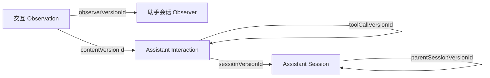

助手会话 Observer 读取 Claude Code 和 Codex 写在本机的会话日志，记下其中的每一次交互：用户说了什么、助手回了什么、调用了哪些工具、得到什么结果、助手的推理，以及产品交给模型的指令和上下文。每次交互还记下它发生在哪个产品、哪个工作目录，以及什么时间。

首次运行时，它导入本机现存的全部会话，之后每 5 秒轮询一次，继续读取新的内容。两个产品共用同一套业务类型，来源记录怎样对应到交互，见 [Assistant Interaction · 粒度](./assistant-interaction.mdx#granularity)。

<ObserverStructure node="ASSISTANT_SESSIONS" />

## 业务类型 [#types]

| 业务类型 | 用途 | 资源名 |
| --- | --- | --- |
| [Assistant Sessions Observer](./assistant-sessions-observer.mdx) | 程序实例自身：一台设备上的助手会话 Observer | `assistant-sessions-observers` |
| [Assistant Session](./assistant-session.mdx) | 被交互引用：来源中的一个会话，包括子 Agent 的会话 | `assistant-sessions` |
| [Assistant Interaction](./assistant-interaction.mdx) | 观测内容：会话中的一次交互 | `assistant-interactions` |

## 程序实例 [#instance]

一台设备上运行一个助手会话 Observer，它读取这台设备上当前用户的日志目录。交互发生的设备就是这个程序实例所在的设备，读取方从 `observerVersionId` 指向的版本读到它的平台和主机名。

程序实例把采集状态保存在自己数据目录的 `capture.sqlite` 中（见 [Runtime · 数据目录](../../hosting/runtime.mdx#data)）：

| 状态 | 内容 |
| --- | --- |
| 身份登记 | 来源身份到 EntityId 的映射，见 [Assistant Interaction · 身份](./assistant-interaction.mdx#identity) 和 [Assistant Session · 身份](./assistant-session.mdx#identity) |
| 读取进度 | 每个日志文件已处理到的位置，以及读到这里时的来源上下文：所在的会话和一轮、模型、工作目录、来源给出的时区，见[读取进度](#progress) |
| 待配对的推理 | Codex 已读到一半、还没有形成交互的推理，见 [Assistant Interaction · Codex](./assistant-interaction.mdx#codex) |
| 待确认的批次 | 已交给 Runtime、还没有收到本地回执的批次，见[提交](#submission) |

这些状态只在本机，后端保存的只有交给 Runtime 的版本。

## 采集 [#collection]

### 来源 [#sources]

| 产品 | 读取的文件 | 已核实的版本 |
| --- | --- | --- |
| Claude Code | `~/.claude/projects/*/<sessionId>.jsonl`，子 Agent 的会话在 `<sessionId>/subagents/agent-<agentId>.jsonl`，旁边的 `agent-<agentId>.meta.json` 记下它的类型、说明和发起它的工具调用 | 2.1.220 至 2.1.309 |
| Codex | `~/.codex/sessions/YYYY/MM/DD/rollout-*.jsonl`；归档的会话在 `~/.codex/archived_sessions/rollout-*.jsonl.zst`，用程序附带的 zstd 解码器解压到数据目录的 `archives/`，读完后删除解压的文件；会话标题在 `~/.codex/session_index.jsonl` | 0.147 至 0.166 |

日志的每一行是一条 JSON 记录。程序实例只读取这些文件，不启动 Claude Code 或 Codex，也不改动它们的配置。Claude Code 会按 `cleanupPeriodDays` 清理旧的会话文件，默认保留 30 天；来源清理文件后，已导入的交互照常保留。

### 轮询 [#polling]

每一轮做三件事：

1. 列出来源目录，找到新出现的文件和大小有变化的文件。
2. 最近有变化的文件各读一段，把新增的完整记录形成交互并提交。一段最多 16 行或 512 KiB。
3. 在这一轮开始后的 3 秒内，继续按段导入还没读完的历史文件，各文件轮流进行。

所以首次导入大量历史时，新的交互每一轮仍然会被读到。两轮之间相隔 5 秒。读取方看到新交互的时间还取决于来源写入日志的时机、积压的数量和 Runtime 的发送。

### 读取进度 [#progress]

读取进度记下每个文件的设备号和 inode、文件大小，以及最后一条完整记录结束的字节位置。

- 文件末尾没有换行的半行留到下一轮再读。
- 文件变短，或者设备号和 inode 变了，就从头重读这个文件。
- 文件移动到新位置（例如 Codex 把会话移进归档目录）时，按新文件从头读。

重读和重复出现的记录形成相同的来源身份，身份登记把它们对应到已有的实体，所以不会形成重复的交互，见 [Assistant Interaction · 身份](./assistant-interaction.mdx#identity)。

### 诊断 [#diagnostics]

下面的情况作为采集诊断记下文件和位置，读取继续处理后面的行，见 [OBSERVER-8](../../core/model/observer.mdx#observer-8)：

- 一行完整但无法解析为 JSON。
- 记录的种类或结构不在已核实的版本中，例如 Codex 新增的事件类型。
- 一行超过 64 MiB。
- 一次交互连同它的原始记录超过 Runtime 一个批次的上限，见[提交](#submission)。

这些记录不形成交互。来源中不形成交互的已知记录种类列在 [Assistant Interaction · 不形成交互的记录](./assistant-interaction.mdx#excluded)。

## 事实时间 [#fact-time]

| 观测内容 | 事实时间 |
| --- | --- |
| Assistant Interaction | 来源记下的时刻：一次输入、一次工具调用或一次结果是时间点，助手的回复和推理在来源给出开始时间时是时段，见 [Assistant Interaction · 事实时间](./assistant-interaction.mdx#fact-time) |

会话没有事实时间。会话持续多久、一轮花了多久，由读取方从交互的时间计算。

`timeZone` 按下面的顺序取值：

1. Codex 每一轮注入的 `<environment_context>` 中有 `<timezone>`，同一会话中，交互取它之前最近一次的值。
2. 记录是在程序实例运行期间写入的：上一轮已经读到这个文件的末尾，这一轮读到了新增的记录。这时取本机当前的 IANA 时区。
3. 其余情况为 `null`，包括首次导入的历史，以及程序实例停止期间写入的记录。

## 提交 [#submission]

助手会话 Observer 使用 [.NET](../../hosting/dotnet.mdx) 的 SDK，交互采用[结束后提交](../../hosting/submission.mdx#strategies)，不写观测预览：来源在一次交互完成后才写入日志，所以读到的交互都已完整，形成后随即结束。

一个文件中一段连续的新记录组成一个批次（见 [Submission · 批次](../../hosting/submission.mdx#handoff)）：

| 业务事件 | 交给 Runtime 的操作 |
| --- | --- |
| 第一次读到一个会话 | 形成会话的草稿，引用它 |
| 会话的标题或子 Agent 信息变化 | 形成会话的新草稿，引用它；之后的交互引用新版本 |
| 读到一次交互 | 原始记录的字节随批次交出；形成交互的草稿和 Observation 的草稿，两者都结束 |
| 读到工具结果，调用已经形成 | 引用调用的交互，写进结果的 `toolCallVersionId` |

交出批次和推进进度按这个顺序进行：

1. 业务代码为新出现的来源身份分配 EntityId，组成批次，给它一个请求标识。批次、新的身份映射和批次完成后的读取进度一起写进待确认的批次。
2. 把批次交给 Runtime。
3. 收到本地回执后，在一次本地事务中写入身份映射和读取进度，删除待确认的批次。

程序在第 3 步之前退出时，下次启动先用原来的请求标识重发待确认的批次，Runtime 返回原来的回执，再继续第 3 步，见 [Submission · 回执](../../hosting/submission.mdx#receipts)。所以每次交互的 EntityId 只分配一次，进度也不会越过尚未交出的记录。

一个批次的序列化大小和操作数都在 [Protocol](../../hosting/protocol.mdx) 的上限之内：超过时，这一段拆成更小的批次。一次交互单独成批仍然超过上限时，它作为采集诊断记下，读取进度越过它，继续处理后面的记录。在已核实的日志中，最长的一行约 3.5 MiB。

### 被拒绝的版本 [#rejections]

| 情况 | 处理 |
| --- | --- |
| 用户删除了某次交互或某个会话（[HISTORY-7](../../core/rules/history.mdx#history-7)） | 身份登记保留它的映射并标为已删除，之后再读到它时跳过。会话被删除后，这个会话之后的交互也跳过 |
| 其他原因 | 报告错误，暂停发送 |

## 实现 [#implementation]

| 平台 | 状态 |
| --- | --- |
| macOS | 已实现，在 Apple 芯片的 Mac 上运行验证 |
| Windows | 代码包含这个平台的路径和文件身份，未运行验证 |
| Linux | 代码包含这个平台的路径和文件身份，未运行验证 |

程序在 `src/Observers/Orisumi.Observer.AssistantSessions/`，安装包 ID 是 `assistant-sessions`，随 [macOS 客户端](../../clients/macos.mdx)附带，由 Runtime 运行。构建和运行见该目录的 README。

测试 Case：[交互的识别](../../testing/observers/assistant-interaction-mapping.mdx)、[工具、分支与子 Agent](../../testing/observers/assistant-interaction-relations.mdx)、[读取与恢复](../../testing/observers/assistant-session-reading.mdx)、[时间与位置](../../testing/observers/assistant-interaction-time.mdx)、[原始材料](../../testing/observers/assistant-raw-entries.mdx)。

## 待定 [#open]

- Claude Code 用 `--fork-session` 分叉时，复制到新会话的记录是否保留原来的 `uuid`。保留时，复制的历史对应到原来的交互；换成新 `uuid` 时，它们形成新会话中的交互。
- 读取其他设备拷来或同步来的日志。到时需要表达交互发生的设备，和运行程序实例的设备分开。
- 早于已核实版本的日志格式。其中不认识的记录现在作为诊断计数。
- Codex 的会话在一轮结束前中断时，读到一半的推理留在待配对的状态中。
