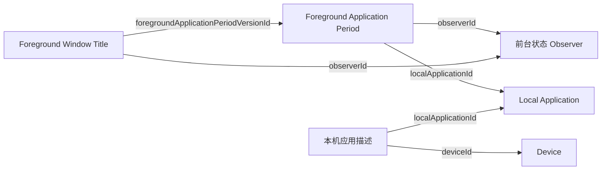

前台状态 Observer 记下某台设备上系统确认的前台应用和窗口标题。两种观测由同一个程序实例形成，各有自己的 EntitySchema 和时间线：标题变化时，应用时段照样延续；标题读取失败时，应用时段照样记录。

它记下的是前台时长。用户是否活跃由读取方组合多条时间线判断，见 [Observers · 前台、输入与设备的时间线](../index.mdx#timelines)。

本页写这个 Observer 的职责和运行规则。程序实例自身也是一种业务类型，它的字段和 EntitySchema 见 [Foreground State Observer](./foreground-state-observer.mdx)。

<ObserverStructure node="FOREGROUND_STATE" />

## 业务类型 [#types]

| 业务类型 | 用途 | 资源名 |
| --- | --- | --- |
| [Foreground State Observer](./foreground-state-observer.mdx) | 程序实例的描述 | `foreground-state-observers` |
| [Local Application](./local-application.mdx) | 事物：设备上的一个应用安装，以及它的描述 | `local-applications`、`local-application-descriptions` |
| [Device](../device-state/device.mdx) | 事物：应用所在的设备，以及它的描述 | `devices`、`device-descriptions` |
| [Foreground Application Period](./foreground-application-period.mdx) | 观测：应用处于前台的一个时段 | `foreground-application-periods` |
| [Foreground Window Title](./foreground-window-title.mdx) | 观测：窗口标题的一个时段 | 待定 |

## 程序实例 [#instance]

- 一个程序实例对应运行的一个前台状态 Observer。同一台设备上可以有两个，它们提到同样的本机应用，各自形成观测。
- 程序版本取运行上下文中的安装包版本，见 [Hosting · 运行上下文](../../hosting/index.mdx#context)。
- 本机应用所在的设备是运行上下文中的运行设备，程序启动时写入设备描述。读不到运行设备时，它报告诊断并等待，见 [Hosting · 运行上下文](../../hosting/index.mdx#context)。

## 采集 [#collection]

应用、焦点窗口和标题在同一次读取中取得，再分别更新应用时段和标题时段。应用的图标只在时段开始时读取，见 [Foreground Application Period · 图标](./foreground-application-period.mdx#icon)。读取由三种情况触发：

- 启动时，读取一次当前状态。
- macOS 报告应用激活、焦点窗口切换或窗口标题变化时，立即读取。切换应用或焦点窗口后，监听目标随之更新。
- 定时读取，确认当前状态。间隔是设置 `intervalMs`，100 到 60000 毫秒，默认每秒一次。

macOS 唤醒后立即重新读取。休眠、读取失败等情况下时段怎样结束和重新开始，见 [Foreground Application Period · 事实时间](./foreground-application-period.mdx#fact-time)。

标题通过所属的应用时段关联到这一段活动，窗口本身没有身份。标题怎样分段，见 [Foreground Window Title · 粒度](./foreground-window-title.mdx#granularity)。

## 事实时间 [#fact-time]

应用时段和标题时段都是时段，各有自己的时间线，边界见 [Foreground Application Period · 事实时间](./foreground-application-period.mdx#fact-time) 和 [Foreground Window Title · 事实时间](./foreground-window-title.mdx#fact-time)。

## 写入 [#submission]

前台状态 Observer 使用 [.NET 的 SDK](../../api/sdk.mdx#dotnet)，写给本地转发。进行中的时段只在内存中补全，时段结束时才写入，所以后端为每个时段保存一个版本，进行中的时段读不到；采样的次数不决定版本的数量。业务事件对应的操作如下：

| 业务事件 | 处理 |
| --- | --- |
| 首次确认应用在前台 | 确定本机应用的识别依据，读取图标，在内存中开始这一段 |
| 再次确认同一段活动 | 把结束边界延到这次确认 |
| 切换应用，或应用名称、时区变化 | 写入当前时段，开始新的一段 |
| 读取失败、停止采集或其他中断 | 当前时段结束于最后一次确认，写入它 |

一个时段是一个请求：先写入本机应用描述，带识别依据；再写入时段，提到本机应用，带时间和图标，代码的形状见 [SDK · 引用和识别依据](../../api/sdk.mdx#references)。两次写入都不查询后端，所以断网时照常，见 [Runtime · 本地转发](../../hosting/runtime.mdx#forwarding)。

程序异常退出时，进行中的时段随之丢失；程序实例的身份不变，新的读数开始新的时段。以后要让进行中的这一段可读，只改写入的时机：见 [API · 一次写入](../../api/writing.mdx#write)。

## 实现 [#implementation]

| 平台 | 应用时段 | 窗口标题 |
| --- | --- | --- |
| macOS | 已实现：本机应用身份、连续时段，时段结束时写入 | 未实现 |
| Windows | 未实现 | 未实现 |
| Android | 未实现 | 未实现 |

macOS 程序在 `src/Observers/Orisumi.Observer.ForegroundState/`，通过 AppKit 读取前台应用，可以持续采集，也可以只采样指定的次数。启动参数见该目录的 README。它作为安装包随 [macOS 客户端](../../clients/macos.mdx)附带，由 Runtime 运行。

用到的 macOS 接口：[应用激活通知](https://developer.apple.com/documentation/appkit/nsworkspace/didactivateapplicationnotification)、[焦点窗口变化通知](https://developer.apple.com/documentation/applicationservices/kaxfocusedwindowchangednotification)、[标题变化通知](https://developer.apple.com/documentation/applicationservices/kaxtitlechangednotification)。

测试 Case：[本机应用身份](../../testing/observers/local-application-identity.mdx)、[时段边界](../../testing/observers/application-period-boundaries.mdx)、[写入](../../testing/observers/foreground-submission.mdx)、[图标](../../testing/observers/foreground-icons.mdx)。

## 待定 [#open]

- Android 上来源身份、重复查询与 Activity 生命周期的对应关系。
- 程序实例本身被用户删除后，前台状态 Observer 怎样继续。
