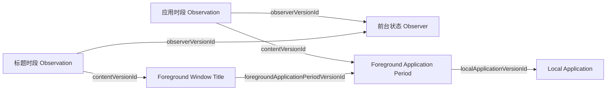

前台状态 Observer 记下某台设备上系统确认的前台应用和窗口标题。两种观测由同一个程序实例形成，各有自己的 EntitySchema 和时间线：标题变化时，应用时段照样延续；标题读取失败时，应用时段照样记录。

它记下的是前台时长。用户是否活跃由读取方组合多条时间线判断，见 [Observers · 前台、输入与设备的时间线](../index.mdx#timelines)。

本页写这个 Observer 的职责和运行规则。程序实例自身也是一种业务类型，它的字段和 EntitySchema 见 [Foreground State Observer](./foreground-state-observer.mdx)。

<ObserverStructure node="FOREGROUND_STATE" />

## 业务类型 [#types]

| 业务类型 | 用途 | 资源名 |
| --- | --- | --- |
| [Foreground State Observer](./foreground-state-observer.mdx) | 程序实例自身：一个前台状态 Observer | `foreground-state-observers` |
| [Local Application](./local-application.mdx) | 被应用时段引用：设备上的一个应用安装 | `local-applications` |
| [Foreground Application Period](./foreground-application-period.mdx) | 观测内容：应用处于前台的一个时段 | `foreground-application-periods` |
| [Foreground Window Title](./foreground-window-title.mdx) | 观测内容：窗口标题的一个时段 | 待定 |

## 程序实例 [#instance]

- 一个程序实例对应本机上运行的一个前台状态 Observer。它重启或升级后沿用原来的 EntityId；另一台设备上的、或独立运行的实例，各有自己的 EntityId。
- 程序实例的 EntityId 由 Runtime 生成和保存，进程启动时从 `init` 读取，见 [Runtime · 数据目录](../../clients/runtime.mdx#data)。程序版本取 `init` 中安装包的版本。
- 本机应用的身份保存在单独的登记文件中，见 [Local Application · 登记文件](./local-application.mdx#registry)。
- 程序实例本身是一个业务实体，EntitySchema 见 [Foreground State Observer](./foreground-state-observer.mdx)。

## 采集 [#collection]

应用、焦点窗口和标题在同一次读取中取得，再分别更新应用时段和标题时段。读取由三种情况触发：

- 启动时，读取一次当前状态。
- macOS 报告应用激活、焦点窗口切换或窗口标题变化时，立即读取。切换应用或焦点窗口后，监听目标随之更新。
- 默认每秒定时读取一次，确认当前状态。

macOS 即将休眠时，当前时段结束；唤醒后重新读取。读取失败时，当前时段也结束，下一次成功读取开始新的时段。锁屏和无输入不影响前台时段。时段边界的完整规则见 [Foreground Application Period · 事实时间](./foreground-application-period.mdx#fact-time)。

标题通过所属应用时段的观测内容关联到这一段活动，窗口本身没有身份。标题怎样分段，见 [Foreground Window Title · 粒度](./foreground-window-title.mdx#granularity)。

## 提交 [#submission]

前台状态 Observer 使用 [.NET](../submission/dotnet.mdx) 的 SDK 库，采用[结束后提交](../submission/index.mdx#strategies)，并写入[观测草稿](../submission/index.mdx#drafts)：进行中的时段在本地补全，同时作为草稿写入后端，读取方能实时读到；时段结束时才冻结 Observation 并安排发送，所以后端为每个时段保存一个版本。业务事件对应的操作如下：

| 业务事件 | 交给 SDK 的操作 |
| --- | --- |
| 首次确认应用在前台 | 识别本机应用；形成观测内容并安排发送；形成 Observation 的草稿 |
| 再次确认同一段活动 | 把新的结束边界合并进 Observation 的草稿 |
| 切换应用，或应用名称、时区变化 | 通知当前时段结束；为新状态形成新的草稿 |
| 读取失败、停止采集或其他中断 | 当前时段结束于最后一次确认，通知结束；恢复后形成新的草稿 |

观测内容形成后随即冻结并安排发送，它引用的本机应用版本也一样；SDK 在它们保存之后才写入草稿。结束当前时段和开始新的时段在同一个批次中提交，见 [Submission · 本地交接](../submission/index.mdx#handoff)。

程序异常退出或停止超时被结束后，下次启动时，SDK 恢复遗留的草稿，业务代码通知它结束于本地保存的最后一次确认。程序实例的身份不变，停机期间不计入时段，新的读数开始新的时段。

### 被拒绝的版本 [#rejections]

| 情况 | 处理 |
| --- | --- |
| 另一个程序实例已为同一个应用保存了首版（[VERSION-6](../../core/model/version.mdx#version-6)），内容相同 | 采用已保存的首版 |
| 用户删除了某个本机应用（[HISTORY-7](../../core/rules/history.mdx#history-7)，或时段的引用违反 [ENTITY-6](../../core/model/entity.mdx#entity-6)） | 为这个安装分配新的 EntityId，更新登记文件，再改写待发送的时段 |
| 其他原因 | 报告错误，暂停发送 |

用户删除的是过去的数据。之后继续采集时，同一个应用以新的身份出现。

## 实现 [#implementation]

| 平台 | 应用时段 | 窗口标题 |
| --- | --- | --- |
| macOS | 已实现：本机应用身份、连续时段、时段开始时提交观测内容、写入观测草稿，经 Runtime 上传 | 未实现 |
| Windows | 未实现 | 未实现 |
| Android | 未实现 | 未实现 |

macOS 程序在 `src/Observers/Orisumi.Observer.ForegroundState/`，通过 AppKit 读取前台应用，可以持续采集，也可以只采样指定的次数。启动参数见该目录的 README。它作为安装包随 [macOS 客户端](../../clients/macos.mdx)附带，由 Runtime 运行。

用到的 macOS 接口：[应用激活通知](https://developer.apple.com/documentation/appkit/nsworkspace/didactivateapplicationnotification)、[焦点窗口变化通知](https://developer.apple.com/documentation/applicationservices/kaxfocusedwindowchangednotification)、[标题变化通知](https://developer.apple.com/documentation/applicationservices/kaxtitlechangednotification)。

测试 Case：[本机应用身份](../../testing/observers/local-application-identity.mdx)、[时段边界](../../testing/observers/application-period-boundaries.mdx)、[提交与恢复](../../testing/observers/foreground-submission.mdx)、[被拒绝的版本](../../testing/observers/foreground-rejections.mdx)。

## 待定 [#open]

- Android 上来源身份、重复查询与 Activity 生命周期的对应关系。
- 程序实例本身被用户删除后，前台状态 Observer 怎样继续。
