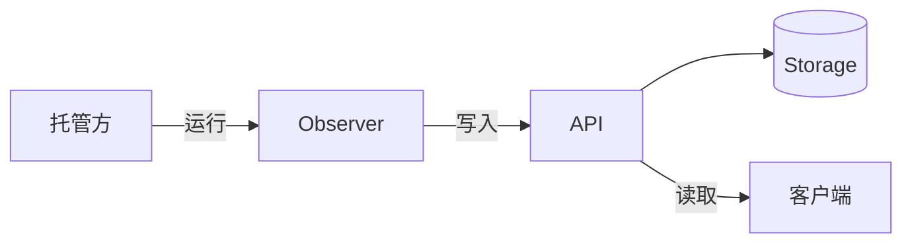

Orisumi 保存一个人经历了什么。经历会过去，软件会更替，但留下的记录仍应清晰可读。

人会换设备、换应用、换 AI 助手，留在这些软件里的信息也随之散落。Orisumi 把它们收拢成一份属于用户的记录：用过的应用、键鼠活动、浏览历史、健康数据，以及模型的推断和用户的确认、否定。这样定位的理由见 [ADR · 定位与边界](../adr/positioning.mdx)。

<Callout type="warn">

项目正在重写。Core 和 ADR 是当前的设计；其他分区和代码有一部分仍按旧模型编写，两者冲突时，以 Core 为准。重写期间只保留当前的设计，被取代的内容直接删除，见 [ADR · 设计层与变更流程](../adr/documentation-authority.mdx#rewrite)。

</Callout>

## 核心想法 [#ideas]

- 每一份观测说明四件事：谁负责、说了什么、依据什么、事实在什么时间成立。
- 数据改动时形成新版本，旧版本保留。引用指向确定的版本，所以追溯时看到的是当时的内容。
- 每种数据的字段和含义由 EntitySchema 声明，和数据保存在一起，换了软件也能读懂。
- 后端只检查结构。一件事实怎样判断，由各来源的业务规则决定。

## 组成 [#system]

数据从来源到用户眼前，依次经过这几部分。每一部分对应文档的一个分区：

新增一个来源，要写的只有业务规则和读取来源的代码。API 负责把数据组织成实体和版本，托管方负责运行程序，见 [Core · 谁决定什么](../core/index.mdx#responsibility)。

| 分区 | 内容 |
| --- | --- |
| [Core](../core/index.mdx) | 所有数据共用的结构与规则，其他分区都遵守它 |
| [Observers](../observers/index.mdx) | 各 Observer 从来源中读到什么、形成哪些观测，以及怎样接入新的来源 |
| [Hosting](../hosting/index.mdx) | 托管方怎样在设备和服务器上管理和运行 Observer，以及怎样接受统一管理 |
| [API](../api/index.mdx) | 后端的 HTTP 接口：所有写入方和读取方共用的数据能力 |
| [Storage](../storage/index.mdx) | 实体、版本、识别依据和 Observer 的管理登记怎样保存在 PostgreSQL 中 |
| [Clients](../clients/index.mdx) | 用户使用的 Web 控制台和设备端客户端，以及它们怎样管理各处的 Observer |
| [ADR](../adr/index.mdx) | 各项决定和它们的理由 |
| [Testing](../testing/index.mdx) | 验证用例与测试报告 |

## 从哪里开始 [#reading]

第一次读，按这个顺序：

1. [Walkthrough](./walkthrough.mdx)：用一天的数据走一遍主要概念。后面各分区的例子都取自这一天。
2. [Core · Overview](../core/index.mdx)：Core 的全貌，以及各类型之间的关系。
3. Core 的类型页：[Entity](../core/model/entity.mdx)、[Version](../core/model/version.mdx)、[EntitySchema](../core/model/schema.mdx)、[Observation](../core/model/observation.mdx)、[InputSet](../core/model/input-set.mdx)、[Observer](../core/model/observer.mdx)。

遇到不熟的词，查 [Glossary](../core/glossary.mdx)。[Graph](./graph.mdx) 展示 Core、ADR、Observers 和 Hosting 页面之间的引用关系，可以沿节点打开相关文档。

有具体任务时，从这里进入：

<Cards className="md:grid-cols-2">
<Card title="接入新的来源">

[Observer](../core/model/observer.mdx)、[Identity](../core/rules/identity.mdx)、[Time](../core/rules/time.mdx)、[History](../core/rules/history.mdx)、[Observers · Integration Guide](../observers/integration.mdx)、[API · Writing](../api/writing.mdx)、[API · SDK](../api/sdk.mdx)

</Card>
<Card title="编写设备端客户端">

[Clients · Device Clients](../clients/device.mdx)、[Clients · Management](../clients/management.mdx)、[Hosting · Runtime](../hosting/runtime.mdx)、[Hosting · Protocol](../hosting/protocol.mdx)、[Hosting · Management](../hosting/management.mdx)、[Hosting · Packages](../hosting/packages.mdx)

</Card>
<Card title="修改后端">

[Version](../core/model/version.mdx)、[Entity](../core/model/entity.mdx)、[EntitySchema](../core/model/schema.mdx)、[API](../api/index.mdx)、[Storage](../storage/index.mdx)

</Card>
<Card title="编写文档">

[Core · Writing](../core/writing.mdx)、[Core · Conventions](../core/conventions.mdx)、[ADR · 设计层与变更流程](../adr/documentation-authority.mdx)

</Card>
</Cards>

## 给 Agent [#agents]

公开站点是 [docs.orisumi.dev](https://docs.orisumi.dev)。每个页面都有 Markdown 版本，地址是页面路径加 `.md`，例如 `/core/model/version.md`，其中的链接也指向 Markdown 版本；全站内容在 `/llms-full.txt`。在仓库中，直接读 `src/Docs/Orisumi.Docs/content/docs/`。工作规则见根目录的 `AGENTS.md`。

## 名称 [#name]

Orisumi（オリスミ）由「織り」和「澄み」两个词组成：把不同来源的经历织在一起，让它们一直看得清楚。汉字写作「織澄」，正式名称用 Orisumi。
